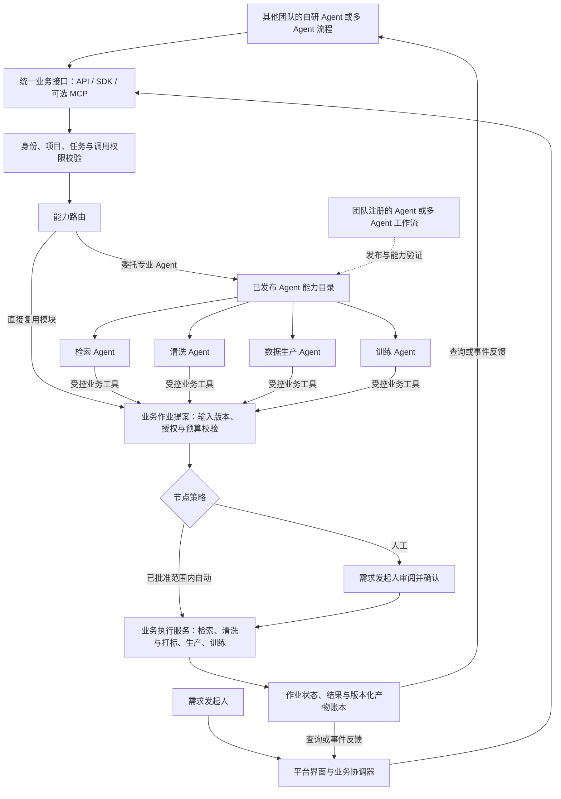
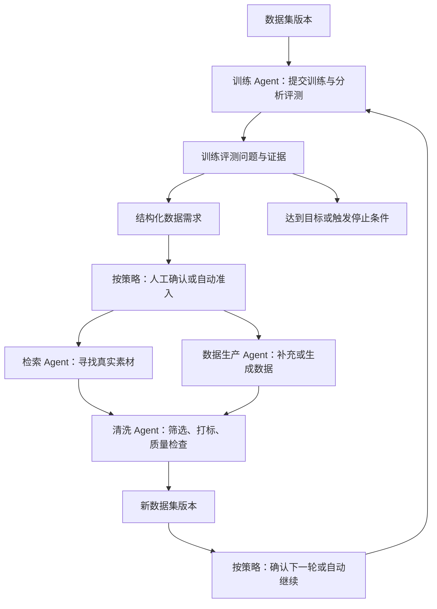

# 可扩展的专业 Agent 接入契约

当前执行范围：[先完善框架、检索优先、清洗独立开发](../docs/architecture.md#17-后续实施顺序)。评测、训练、RHF 暂缓；下文完整生命周期是远景架构。

统一调用首片：[Agent 作业服务与候选交付](agent-jobs.md)，支持 HTTP/SDK、原人工确认、后台恢复和原 manifest 产物查询。[原 Chat 接线](../docs/dev/retrieval-agent-window.md)按项目显式启用；当前本机8096保留成熟自然对话，检索Agent承接确认前词表和确认后执行，已确认任务可使用中控“安排下一步”。其他环境不因本机配置自动启用，更多业务域未开放。

交接与下一批实施入口：[落地说明、当前边界及第一优先级遗留](../docs/architecture.md#16-当前实现与验证矩阵)。

两张总览图统一见 [业务全通路与 Agent 协作图](../docs/architecture.md#15-目标平台与后续业务域)：分别展示数据获取至训练再检索的闭环，以及检索/清洗等专业 Agent 的接入与协作。下文保留详细契约和局部图。

## 架构决策

目标从“检索/清洗两个固定角色”扩展为专业 Agent 平台。检索、清洗、数据生产和训练是业务域内的专业角色，可分别选择独立实现和运行框架。检索/清洗是第一批接入业务，不是公共运行接口的角色上限。

平台面向多个团队。团队可以保留已有 Agent、多 Agent 编排和运行框架，只复用平台的检索、清洗、打标等业务能力；也可以将自己的 Agent/工作流注册成平台可派发的能力。采用平台协调器和 DSH 均不是模块复用的前提。

平台中控可由现有 Chat 主角色承担，并由 DSH 或其他已安装 Harness 承载：读取真实进度、选择能力、提出有界委派方案；原业务服务负责实际派发、确认、权限、预算及版本，不再增加一个重复的总 Agent。已确认任务的首片接线见 [中控落地](../docs/dev/platform-coordinator.md)，普通提单对话暂不整体替换。业务上允许训练 Agent 直接向检索 Agent、数据生产 Agent 提出数据需求；目标是通过持久业务事件和有版本的产物引用异步交接，不代替其他域批准任务或直接写其他域账本。训练闭环仍未接通。

## 整体平台流程图（目标架构）

检索与清洗／打标两个模块从接入到交付的完整流程见 [双模块业务流程图](../docs/architecture.md#6-清洗-验证-去重与补数)。

这张图表示完整接入与执行关系，不代表所有模块已完成。已实现范围见本文末尾及 [共享模块首片](shared-capabilities.md)，实施顺序见 [平台待办](../docs/architecture.md#17-后续实施顺序)。

外部团队可以只调用模块，也可以把自己的 Agent 注册为可被调用的能力。专业 Agent 内部使用 DSH、自研框架或其他 Harness，由各自实现决定；这些框架不作为业务流程出口。人工节点按策略等待发起人确认，自动节点沿已批准范围执行。

## 训练反馈环路图（目标架构）

图中是业务反馈方向；业务协调器负责各箭头的持久投递、依赖、确认、预算和代次校验。检索与生产可以按需选择一个，或按同一缺口拆分协同。DSH 等 Harness 是各 Agent 内部的实现选择，不是流程出口。

## 多团队自助接入与模块复用（目标机制）

统一业务能力层与 Agent 托管层分开：

| 接入方式 | 团队保留什么 | 平台负责什么 |
| --- | --- | --- |
| 调用共享能力 | 自研 Agent、多 Agent、自己的协调器/训练系统和 Harness | 通过版本化 API/SDK 接收模块任务；检索/清洗等专业 Agent 也可作为能力调用；执行本侧授权、确认、额度、幂等、状态及产物校验 |
| 注册为可派发 Agent | 独立服务、SDK 或多 Agent 工作流的内部实现 | 自助登记已发布能力、输入/输出契约、版本、连接配置引用及工具需求；经过协议/能力验证后按项目授权发现和派发 |

API/SDK 是业务能力的稳定底座，MCP 是同一业务工具的可选包装，不复制确认/执行逻辑。团队可以直接调用确定性检索/清洗作业，也可以委托专业 Agent 自主规划；不是所有调用都必须先运行一轮 Agent。HTTP/SDK 的检索/清洗共享后端首片已接通，见 [共享模块接口](shared-capabilities.md)；MCP 仍为规划入口，更多业务域的共享执行和产品化属于后续工作。

共享调用以异步业务作业为单位：输入使用已确认需求和可授权解析的素材/数据集引用，提交携带幂等键及版本；返回 job_ref，查询或订阅真实进度，完成后返回有摘要/血缘的产物引用。外部团队保留自己的根任务标识，平台保存 external_task_ref/root_request_ref 到本侧任务/作业的关联，不要求把训练任务伪装成检索任务或完整迁移到平台。

自助接入不要求平台开发者为每个团队修改核心分支。团队在自己命名空间内登记实现发布、能力说明、契约、连接配置引用、版本和运行范围；安装适配器/连接器负责验证并解析配置。运行配置不能动态导入未安装代码；实际服务连接和凭据由后端登记/解析。团队可独立更新版本，已有运行固定原发布版本。仅登记描述不等于能力已验证或数据已授权。

多 Agent 有两种合法接法：将整个团队工作流封装为一个能力入口，内部编排由该团队管理；或将参与者分别登记，让平台按事件和产物依赖编排。两者都不能通过拆子任务重置平台预算。平台管理的参与者保留根任务、父运行、需求版本和实现发布的关联，各自只获得必需的工具/产物权限。

主体按团队/项目及现有租户边界隔离。调用身份由后端认证并关联需求发起人，不接受模型自填 owner。发现某个共享模块不等于能读取其他团队的数据；共享数据、数据集和模型产物需要独立授权。配额分别约束团队、项目和根需求，子任务分配不超过父级剩余额度。

预算责任按接入方式区分：外部 Agent 自行编排时，平台控制本侧模块和作业用量，外部模型/训练资源由其所属系统负责，不冒称已计量；若纳入平台托管运行，则必须满足对应模型/资源准入和硬上限。无需为单纯调用检索 API 的外部 Agent 强行更换其 Harness 或接管其内部模型循环。

## 可配置的人工确认节点（目标机制）

人工确认是流程节点策略：新数据需求、候选/标签验收、启动下一轮训练、接纳模型结果等节点可配置为 manual 或已授权范围内 auto。用户配置 manual 时即使未超预算也要等待；未配置自动范围不能仅凭 Agent 建议自行执行。现有节点默认/已批准语义不因架构扩展改变。

确认由需求发起人执行，不因多团队参与而引入多人会签。外部 Agent 可以提交待确认提案，不能代替人工节点签字。外部入口提供审批查询/通知及前往平台或对接确认入口的方式，服务端统一核验确认主体。

确认对象绑定展示过的需求/计划摘要、输入数据集/清单版本、实现/能力语义版本、资源范围和有效代次。修改这些内容使旧确认失效；重复点击/回调只生效一次。拒绝、要求修改和取消有明确状态，不能以超时默认通过。选择修改时先保留草稿，未经确认不创建正式任务/作业运行。

人工与自动节点都走相同的版本/授权/预算边界，按授权流程继续闭环；新的数据来源、硬条件或超额资源仍须重新确认。平台保留各节点提案、确认、派发和产物血缘，便于参与团队定位问题。

## 训练反馈驱动的数据迭代（目标契约，未接通执行）

训练 Agent 从实际训练/评测结果中分析薄弱场景，形成带证据的数据需求。例如“夜间雨天行人召回不足”，转成场景、数量、来源与标签要求，直接面向检索/数据生产 Agent 投递。训练失败、依赖故障、评测未知不能自动解释为数据不足；训练参数问题可留在训练域处理。

新增目标产物为 `data-gap-request@1`，不是一段自由文本，也不是扩大权限的凭据：

| 内容 | 必须绑定的信息 |
| --- | --- |
| 需求身份 | iteration_id、request_id、problem_id、修订版本及需求摘要 |
| 问题来源 | 训练 run/checkpoint、输入数据集版本、评测集与评测报告引用/版本、问题样例或统计证据 |
| 需要的数据 | 素材类型/场景、目标数量或分组配额、筛选条件、标签 schema、质量与去重要求 |
| 路由与资源 | retrieval/data_production 的分工、已授权来源/生产能力、资源预算和截止条件 |
| 验收及状态 | 数据验收标准、模型改善目标、交付引用、pending/fulfilled/partial/blocked 等实际状态 |

平台提供受控的“提出数据需求”工具（待实现），写入需求及待派发事件后返回 request_ref。训练 Agent 不需要等待检索 Agent 的同步调用栈结束；协调器按事件唤醒目标 Agent，重试继续同一 request_id，接收方用该 ID 和需求版本做幂等。一个缺口分配给检索与生产时要共享数量和验收账本，不能各自声称满足全部缺口后重复累计。

检索/生产输出进入清洗和质量验收，合格数据形成新数据集版本，冻结新增/复用样本、标签与来源血缘，再触发下一训练轮。补齐素材数量不等于模型改善，必须用新训练/评测结果核对目标。合成数据保留生产来源，不混写成真实采集素材；评测样本不直接混入训练集。

迭代按已配置的人工节点和已确认自动范围推进：自动节点在来源、能力、质量目标和预算内无需逐轮重复确认，人工节点等待需求发起人；改变硬条件、数据授权或超出批准资源范围也需重新确认。业务层按训练轮/数据集版本/有效代次核验事件，旧运行不能覆盖新需求或重新触发当前轮。

停止条件必须明确：达到评测目标、总轮数/时间/资源耗尽、连续无改善、没有可用数据或用户停止。外部训练完成未知时先核对原作业，不能直接重复训练；循环状态和阶段任务均持久化。该闭环需要数据生产/训练领域服务及跨域协调实现，当前公共注册机制不等于它已可运行。

## 必须分开的概念

| 概念 | 例子 | 归属 |
| --- | --- | --- |
| 业务域及任务契约 | 检索任务、数据生产任务、训练任务 | 域插件和各自业务服务 |
| 专业角色 | retrieval / cleaning / data_production / training | 版本化 RoleDefinition、输出契约、工具清单 |
| Agent 实现 | 自研清洗 Agent、Data-Juicer Agent | 安装的适配器及其版本/发布摘要 |
| Harness | DSH 或独立 Agent 内部自带框架 | 运行实现内部，不写入业务状态模型 |
| 执行器 | 向量检索、DJ plan_flow、标签检测器、训练作业服务 | 已批准的业务作业接口 |

Data-Juicer Agent 是可替换的自主规划实现；Data-Juicer plan_flow 是可复用执行后端，两者不等同。独立 Agent 自带 Harness 时由适配器直接包装其生命周期，不再强制套一层 DSH。

## 当前代码扩展点

1. `AgentStageBinding` 是运行层需要的最小协议：role、input_digest、model_binding_digest、stage_digest。领域任务身份、版本、generation 等字段由域模型和授权服务提供；不能只满足四个字段就获得运行权限。
2. `AgentDomain` 显式绑定 domain_ref、task_contract_ref、实际 stage_type、角色发布、ToolCatalog、授权 guard 和 task_kind。构造时核对工具归属；调用前核对具体任务类型、角色发布和任务种类。
3. `AgentDomainRegistry` 只登记后端安装的域对象。配置不能指定模块路径/类名、上传代码或自动创建一个训练域。
4. `build_registered_agent_runner` 为各域复用 HarnessRunner/DurableHarnessRunner。角色路由必须覆盖该域全部已登记角色，不能漏路由、选未知发布或默默回退。
5. 需要持久化时，journal.task_contract_ref 必须与域一致。SQLiteHarnessJournal 默认实现 retrieval-cleaning-stage@1；中控专用派生实现显式绑定 platform-coordination-stage@1、codec、授权和模型预算。生产/训练不能仅增加角色或借用检索 scope；它们需实现自己的任务授权、状态机、资源账本和恢复规则。
6. `StageCodecRegistry` 由后端显式登记类型及编码/解码函数。新域采用 harness-invocation@2 加 stage_contract_ref；旧检索/清洗信封保持原形和摘要。未登记的域/编解码拒绝，没有动态 import。

本片 build_registered_agent_runner 仍是规划/分析运行入口，execute 工具继续阻断；后续各域须经持久业务作业接口接入执行，不能仅修改 task_kind 白名单开放副作用。

通用 RoleDefinition、ToolDefinition 和路由支持登记的新角色。现有 AgentStageTask、AgentPlanningService 和公开阶段 API 仍只支持检索/清洗；没有因为基础协议扩展而开放数据生产、训练或任意执行。

## 独立 Agent 的安装与装配

适配器实现既有 HarnessAdapter 的 describe/probe/start/poll/cancel/close。start 接收后端构造的信封和受控工具；可以包装 SDK、本机进程或独立服务。适配器管理供应商会话映射，业务服务管理批准、资源与结果。输入和工具调用均绑定当前任务；最终文字和退出码不等于有效业务提案。

检索/清洗装配增加 harness-routes@2。发布项 provider=registered 只接受 adapter_id 和 artifact_digest，并通过 installed_adapters 查找后端实际安装对象；DSH 发布继续走 provider=dsh，旧 harness-routes@1 保持兼容。公共阶段服务可通过 adapters_provider(actor) 注入当前主体范围内的实现。配置不得提供任意 endpoint、解释器命令或 import 路径；连接与凭据由安装适配器的后端配置解析。

独立 Agent 也必须通过真实 probe 和相同的工具/预算边界。持久规划要求 model_call_admission；仅能上报结束文字、无法控制模型出口的实现不能冒充具备该能力。注册或 SDK 安装不等于通过生产准入。此片没有安装或联通真实 Data-Juicer Agent。

## 各域接入时必须交付

清洗与质检统一由同一个清洗 Agent 承载。清洗、处理和质检是不同任务/能力模式，质检接口可单独调用；只请求质检时不默认改数据，不新增独立质检 Agent 角色。

| 域 | 输入及有效输出 | 业务执行与验证 |
| --- | --- | --- |
| 检索 | 已确认需求/来源、检索策略、候选清单 | 物理绑定、游标、授权、召回证据；有效数由业务层计算 |
| 清洗 | 候选清单、处理诉求、处理计划、事实/标签 | 发布能力、逐素材结果、类型/未知校验；复用过滤执行和标签账本 |
| 数据生产 | 有版本的数据/模板/生产要求、生产计划、数据集 manifest | 生产作业、质量/去重/来源校验；版本完整性和资源限额 |
| 训练 | 数据集版本、训练要求、训练计划、作业/检查点/评测引用 | 模型/资源白名单、GPU/费用配额、异步作业核对、模型发布确认 |

产物交接须包含可授权解析的逻辑引用、类型/schema、内容摘要、版本和来源任务/运行。引用不等于下载凭据。生产数据量、标签完整性、训练指标由对应业务服务验证，Agent 不自报成功数量或自行把模型发布为正式版本。

资源策略统一接入思路，计量单位保持领域语义：规划模型调用、素材/检测次数、生产样本数、GPU 时间和费用不能共用一个含义模糊的 max_calls。依赖完成、取消请求和确实停止分开记录；外部完成未知时核对作业，不能自动重跑有费用或副作用的动作。

## 本片证据与剩余工作

已实现通用域注册、任务绑定协议、角色/工具/路由扩展、独立实现装配、域编解码及持久账本匹配检查。测试以数据生产/训练夹具验证新域接入、进程协议与隔离，不声称已有真实生产或训练 Agent。检索/清洗旧契约和门禁保留。

中控首片新增 coordination 工作流、受限能力目录、原业务端口派发意图/回执、同代次模型上限及原窗口入口。DSH rc.5 和后端已安装适配器均复用相同运行协议；当前只覆盖既有检索/清洗根任务的有界安排，未实现跨域完成事件、多 Agent 并行依赖或训练循环。

尚需：多团队自助注册/发布与发现、共享网关/SDK的更多业务域和产品化、真实平台凭证/委托集成、外部多 Agent 的根预算关联、跨域人工节点与审批前端；真实独立清洗 Agent 的 SDK/服务适配和准入；清洗标签执行/账本/交付；生产与训练各自的任务模型、授权/状态机、业务工具、作业适配器、资源账本和生产部署验证。现有双 Agent 切片继续作为首批业务集成，正式新模式任务准入仍关闭。
