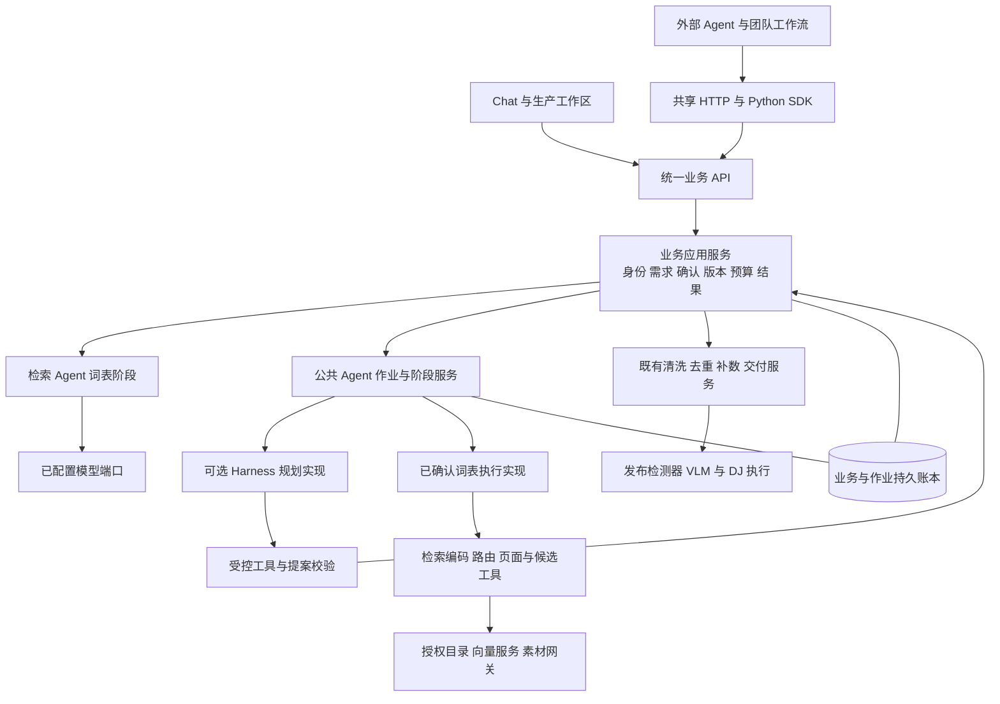
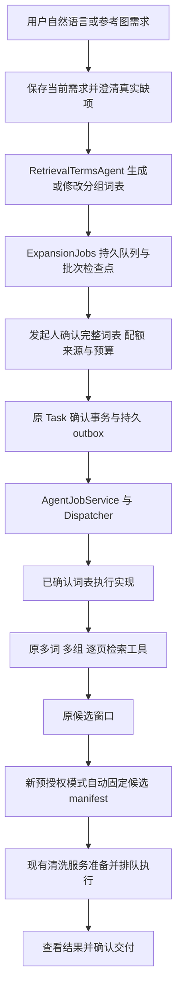
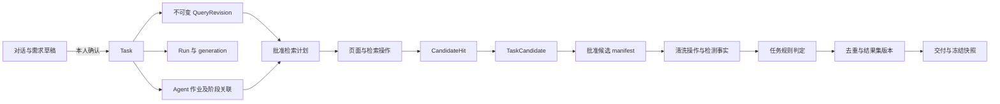
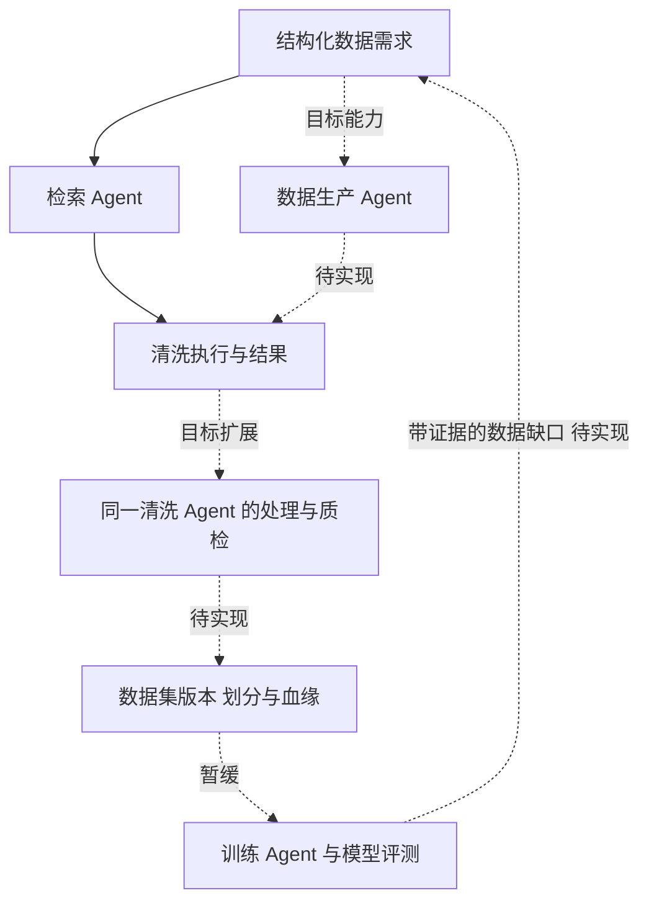

# 数据检索与专业 Agent 平台架构总览

维护基准：2026-11-26。适用对象：产品、架构、后端、前端、算法、测试及接入团队。

本项目以数据需求为起点，提供需求沟通、分组扩词、授权检索、候选确认、清洗去重、补数与交付能力，并逐步将这些能力开放给独立 Agent 和外部工作流。当前建设顺序是完善公共框架、优先检索 Agent、清洗 Agent 独立开发；产品级评测、训练、RHF 暂缓。

默认 Chat 已采用同一检索能力的确认前词表阶段和确认后执行阶段，复用原有词表、查询分支、配额及执行账本。完整的召回质量反馈、自主改词、跨来源策略和训练驱动数据迭代仍有待贯通。数据生产、训练以及团队自助发布等内容在本文中明确标为目标架构。

本文是项目统一阅读入口，汇总设计边界、当前实现和维护位置。详细字段、错误码及历史交付证据分别保留在契约、代码和进度记录中。最近现场状态引用已有交付记录，本次文档整理不代表重新部署或运行验收。

## 阅读导航

| 阅读目的 | 优先阅读 |
| --- | --- |
| 快速了解系统和当前交付 | 第 1、2、3、16 节 |
| 理解图片业务端到端流程 | 第 4、5、6、7 节 |
| 接入 Agent、替换 Harness 或复用能力 | 第 8、11、12、20 节 |
| 做存储、恢复、部署和运维 | 第 9、10、13、14 节 |
| 了解视频和后续平台建设 | 第 7、15、17 节 |
| 查代码、契约和设计依据 | 第 18、19 节 |

## 1 项目定位与不可变边界

### 1.1 服务对象和接入方式

项目同时面向平台用户和外部团队。平台用户通过 Chat 与生产工作区沟通需求、确认方案和查看结果；外部团队可以保留自己的 Agent、协调器和训练系统，通过 API/SDK 复用检索、清洗等模块，也可以由可信后端装配将自研实现注册为可派发能力。

这两种接入方式不同：调用平台工具无需采用平台内部 Harness；替换某个 Agent 实现则必须满足该能力的输入输出、授权、生命周期和版本契约。当前已具备后端安装对象、发布路由与共享接口基础，团队在线自助注册、发布、绑定门户仍待实现。

### 1.2 核心架构决策

| 决策 | 具体约束 |
| --- | --- |
| 业务服务保存权威状态 | 模型、DSH 会话、DJ 任务和前端文本均不能成为业务状态或数量的权威来源 |
| Agent 提议，业务层校验 | 查询、处理计划和修改先成为结构化提案；执行需要对应的有效批准 |
| 只有需求发起人确认 | 不实行多人会签；集成 Agent 可提案、查询或执行已授权动作，不能代替发起人批准 |
| 草稿不创建正式业务运行 | 需求对话和词表作业可持久化，但确认前不创建正式 Task、batch、revision 或执行 run |
| 原模型和原公共契约演进 | 兼容接口与调用方一起交付，不复制平行 Task、候选或视频公共模型规避约束 |
| 存储可替换 | 业务账本通过端口接入；PostgreSQL 是候选而非必装依赖；内存只供开发 |
| Harness 可替换 | DSH 是已安装运行实现之一；业务模型和对外接口不依赖厂商会话对象 |
| DJ 以执行复用为主 | 适配既有 `plan_flow`；Data-Juicer Agent 与 Data-Juicer 执行组件是两个概念 |
| 未知保持未知 | 网络结果、模型判定或外部执行未知时，不自动视为成功、不伪造空结果、不盲目重发 |
| 运行必须受限 | 来源、条件、模型调用、检索调用、命中名额、轮数和时间分别校验，子任务不能重置根范围额度 |

### 1.3 状态标记口径

本文使用“目标设计”“已有代码”“定向验证”“本机部署记录”“真实环境验收”区分不同证据。接口定义、合成夹具通过、本机 LOCAL_CLIP 验证及真实内网试点不能互相替代。后续章节的“已接通”只指其注明的能力和环境。

## 2 总体分层与职责

当前采用模块化业务服务及持久后台作业，不以拆成多个微服务作为前提。逻辑职责分为六层：

| 层 | 负责 | 关键边界 |
| --- | --- | --- |
| 用户交互 | 连续对话、词表审阅、人工操作、进度与结果展示 | 不在前端自行批准或推导权威有效数 |
| 业务应用 | 需求、Task、版本、确认、权限、计数、产物和交付 | 所有执行写入最终经过这一层校验 |
| Agent 工作流 | 专业策略、独立作业、阶段及实现路由 | 规划完成与业务完成分开 |
| Harness 与模型 | 运行角色提示、调用模型和受控工具 | 实现发布固定；不接收任意代码、地址或凭据 |
| 执行业务工具 | 编码、检索、素材物化、清洗、去重、补数 | 消费批准输入；工作回传重验代次与权限 |
| 数据与外部资源 | 账本、元数据、向量索引、媒体、执行环境 | 目录、向量与业务账本有不同权威职责 |

## 3 当前检索的三种路径

### 3.1 默认 Chat 路径

默认 `chat_entry=conversation`。用户保持原来的连续沟通体验，确认前进入 `retrieval-terms@1`，确认后进入 `confirmed-terms-retrieval@1`。

- `RetrievalTermsAgent` 负责确认前分组、分批补词、反馈改词及模型输出校验。
- `ExpansionJobs` 负责持久排队、权限/版本校验、进度和检查点，不另建平行词表账本。
- `TermsModelPort` 复用现有模型/Harness 适配器；拆分职责不自动更换 Chat 默认模型。
- 发起人确认后固定完整词表、分支、配额、来源和预算。执行阶段不再请规划模型压缩或重写这些词。
- 新 `confirmed-terms-execution@2` 在词表确认中批准自动固定首批候选 manifest 并进入现有清洗服务；可选“先审候选”。input_only 在首批查询页提交后交接，不隐式翻完剩余游标或开启补数。旧 @1 和历史任务保留原人工确认与分页语义。验证边界见[三类需求闭环验证](dev/reports/requirement-loop-validation.md)。
- 自动清洗使用既有 `ConfirmedCleaningService` 和清洗后台，不表示独立清洗 Agent 已接通。重新修改词表沿原 Task 的新 revision/generation 处理，旧作业不得覆盖新结果。

### 3.2 独立规划候选路径

显式 `chat_entry=candidate` 或通过独立 Agent API 调用时，可运行 Harness 规划候选工作流：

已有正式确认需求 → 准备规划草稿 → 发起人确认规划 → 启动规划 → 有效策略回执 → 编译物理计划 → 发起人确认检索 → 有界页面检索 → 发起人确认候选 → 交付 manifest 引用。

该路径当前适用于受限图片文本纯候选模式。`retrieval-agent-job@1` 单页；显式装配 `@2` 并获得 paginate 授权后有界多页，支持上限由部署和来源能力共同约束。它尚未完整承接默认路径的多组配额、参考图、历史排重及清洗补数语义，不能当作默认路径的无损替代。

规划阶段 API 的 `execution_allowed=false` 描述规划工具权限；后续业务计划单独确认后，执行器才可以检索。二者并不矛盾。

### 3.3 历史兼容路径

旧 Task、未委托的旧请求、历史批准和既有执行记录保留原含义。不因为启用 Agent 框架就自动迁移、重试或改变模型绑定。老流程的对话、扩词、逐词检索、清洗和补数仍是新路径复用的重要业务基础。

| 方面 | 默认分组词表路径 | 独立规划候选路径 | 历史路径 |
| --- | --- | --- | --- |
| 查询形成 | 用户审阅完整分组词表 | Agent 提交策略，再确认物理计划 | 原确认方案 |
| 执行时再规划 | 不重写已确认词表 | 按该工作流已确认的策略执行 | 按旧批准语义 |
| 当前产物 | 原候选 manifest | 单页或多页原 manifest 引用集合 | 原业务产物 |
| 清洗有效数 | 另由清洗与业务层计算 | `accepted_count=null` | 按原规则计算 |
| 开放方式 | 已有本机默认接线记录 | 项目和部署显式启用 | 保留兼容 |

## 4 需求理解与词表管理

### 4.1 对话与正式任务分离

对话会话保存原话、双方消息、当前有效需求和版本。模型提出需求修改后，服务端校验并持久化，再返回本轮变化。解释、状态询问和修改区分处理；“已开始检索”等表述必须有执行事实支撑。

必需的目标类型、检索主体和图片数量齐全且没有影响检索的歧义时，直接准备待确认词表。用户已说明的信息不反复询问；口头表达同意或模型返回 `confirm_terms` 都不替代页面上的本人确认。

对话命令已有持久接收、异步回执和检查点机制。断网后先查询原命令结果；已保存提案恢复时重放原写入，不重新解释旧消息。浏览器“暂停等待”与取消业务任务是不同动作。

### 4.2 类别与数量语义

图片张数、单图对象数、检索词数是三个独立概念。“一只狗吃饭”的“一只”属于画面，“每类 20 张”属于图片配额，不能混算。

当前已有 `requirement-draft@1` 结构化类别草稿代码，保存类别标识、画面、图片数量、类别专属条件及原话依据，支持类别增删改和数量/条件操作。相关开发记录仍标注进行中，真实模型验证出现过协议拒绝、超时及范围理解问题；不能将这一切片写成所有自然语言诉求已稳定覆盖。

以三个类别各 20 张为例，业务应保存三个配额并求和为 60。只给总量时不平均分配；修改狗的配额不应重写兔子的动作或把狗的专属条件提升成共同条件。无法确定作用范围时仅澄清该范围。

### 4.3 分组词表契约

`grouped-expansion@1` 区分主标签、辅助词、组标识和可选 `delivery_target`。辅助词定义召回分支，不是新的交付类别；素材张数不能直接当作词数。

词表阶段按有界批次生成、保存检查点，并校验组名、数量、重复词、摘要和最终模型绑定。失败批次可以按既有作业规则明确重试；半成品不能作为完整词表确认。模型/Harness 返回后、保存检查点前再次核对当前范围和配置。

新旧词表路径共用作业：规范路径为 `/retrieval-agent/terms`，旧 `/expansion-jobs` 保持兼容别名。提单前会话和已绑定 Task 的共享调用具有不同授权边界，不能互相借用权限。

详见 [对话契约](../contracts/dialogue-turn.md)、[分组词表](../contracts/grouped-expansion.md)、[词表 OpenAPI](../contracts/retrieval-terms.openapi.yaml)。

首次由模型保存或替换主体时，必须通过 `requirement_edits` 保存类别和场景；只有总数时不擅自分配各类配额。新增字段缺失或证据不符会进入有界协议修复，不将未结构化的多类文本直接视为完成。新 Chat 标记在命令入账和草稿保存时清除，刷新恢复同一命令、草稿及扩词作业。

## 5 查询计划与检索执行

### 5.1 从词表到物理查询

确认需求 → 逻辑查询分支 → 授权库路由 → 编码/索引能力匹配 → 整组物理准备 → 计划批准 → 按页执行 → 素材映射与授权读取 → 候选清单。

- 保留原始需求、主词和辅助词的来源；分支关联 `group_id`、词角色、源词和策略版本。
- 编码器、预处理、向量维度、度量、索引版本和绑定必须兼容；目录中出现某个库名不等于已获授权。
- 同一素材可能被多个词、库、索引命中。候选身份与命中证据分开保存，不能按命中行数计交付数量。
- 游标、快照、查询指纹和页边界由业务计划及网关控制，模型不能自造游标或执行位置。
- 参考图使用独立图片查询输入。附加文字默认作为约束，不能无声明地改成图文混合向量召回。

### 5.2 当前召回策略及其边界

已有本地图片策略包括保留原查询、逐分支召回、可信元数据关键词与向量 RRF 融合，以及批准窗口内渐进扩大候选深度。轻量关键词通道不是完整中文 BM25，也不能据此声称所有外部向量服务已支持混合检索。

自动补数图片计划可按授权目录顺序，为每个查询分支优先执行一个兼容索引，其余批准索引保留为延后范围。后续根据清洗及历史排重后的有效新增选择继续或探测其他批准分支。未测量不等于失败，零新增不意味着永久禁用。

这些确定性策略与“Agent 根据实际召回质量主动生成新词”的闭环不同。当前工作树已出现召回反馈读取等增量代码；在完成对应交付验证前，仍按开发中处理。新词、来源扩大或硬条件变化不能借补数自动获得批准。

详见 [查询分支](../contracts/query-branches.md)、[路由](../contracts/query-routing.md)、[物理准备](../contracts/physical-query-preparation.md)、[召回闭环](../contracts/recall-loop.md)、[有效新增策略](../contracts/recall-strategy.md)。

### 5.3 切片覆盖

图片数据库切片按不同数据分片管理，不能以“取最新几个文件”冒充全库覆盖。可信切片目录声明逻辑库、索引版本、稳定切片 ID 及可用状态，配置检查和实际执行覆盖分开记录。

组合 CLIP 首期按每个物理绑定最多 4 片分组，复用已有作业、调度和预算。覆盖展示区分待查、成功访问、失败、搜尽和未知；只访问过一页不等于搜尽，达到数量不等于全库最相关。真实切片映射、容量、跨组背压与按有效数提前停止仍有各自接线边界，见 [切片覆盖契约](../contracts/shard-coverage.md)。

### 5.4 调度与执行预算

服务实例已有有界首轮队列、用户轮转、同用户互斥和共享执行槽。默认治理参数为 2 个线程、128 个执行中/待执行项、同用户 16 项；这些是配置默认值，不是生产容量结论。

按租户/用户/项目/Task/revision/generation 预留检索调用和原始命中名额，默认上限分别为 128 和 1000。分支、库、首轮、手动和补数合并计量；普通 task_version 变化不重置额度。已发出或完成未知的请求保守保留预留，不自动退额。

耗尽时持久记录停止原因并保留已有结果，不伪造空页、不认定目标满足，也不自动增加额度。当前公平队列主要是单实例治理；跨实例全局公平调度仍需验证和建设。详见 [执行治理](../contracts/search-execution-controls.md)。

## 6 清洗 验证 去重与补数

### 6.1 清洗执行主链

已确认候选输入 → 解析已发布检测能力 → 编译不可变清洗配方 → 发起人审阅确认 → 检测器/VLM/DJ 执行 → 保存逐素材逐规则结果 → 业务汇总与去重 → 发布结果版本。

清洗执行复用 `ConfirmedCleaningService`、多规则执行器和既有 `plan_flow` 适配。DJ 的成功状态或输出文件数不直接更新业务有效数。执行输入绑定原 manifest、规则、模型/算子版本、配方摘要及 generation。

Agent 规划桥接目前仅支持 `filter`，将有效处理计划回执编译成原清洗批准提案。`tag/rank/analyze` 及其混合要求明确拒绝，直到类型化执行、标签账本和交付适配接通。普通清洗执行链已有能力，不等于完整独立清洗 Agent 已交付。

### 6.2 检测事实和业务判定

必须区分四类数据：源素材及版本、检测事实、任务相关规则判定、最终交付成员。共享素材不能靠一个全局 `is_valid` 表示所有用户的合格结论。

硬规则采用 `pass/fail/unknown`。只有当前版本全部硬规则为 pass 才能进入自动有效集；失败、未知、缺输出不算通过。人工复核保留素材版本、原判定、规则和证据，不直接覆盖历史事实。

结果视图区分有效、未通过、待复核、重复、候补及人工排除等业务处置。重复事件计数与去重后的审计条目数量可以不同，不能混用。

### 6.3 去重与配额

- 候选身份去重、SHA-256 内容精确去重、近重复/人工重复簇是不同语义。
- 当前图片交付使用精确内容策略；不能把规范中预留的近重复能力当作全部启用。
- 历史排重使用用户显式选定、冻结且仍可授权解析的交付快照。换库、翻页或换轮不重置历史基准。
- 多组有效数按实际分组分配和组配额计算，某组富余不能补另一组缺口；同一成员不重复满足多个配额。
- 历史基准失效、来源撤权或摘要不一致时拒绝沿用，不能以旧审批绕过当前检查。

### 6.4 补数

补数缺口来自当前权威有效去重数。依据目标和各组缺口，在已批准词表、来源、分页、轮数、检测调用和无进展限制内继续。达到目标、固定输入结束、来源耗尽、预算停止或连续无进展分别记录原因。

普通继续翻页无需每次重新调用规划模型；新词、扩大来源、改变硬规则或超范围预算必须回到相应草稿与确认流程。独立纯候选工作流不会自动变成清洗有效数驱动的补数任务。

详见 [多规则清洗](../contracts/multi-rule-cleaning.md)、[发布检测器](../contracts/vlm-approved-detector.md)、[历史排重](../contracts/historical-dedup.md)、[补数计划](../contracts/refill-planning.md)。

新清洗操作直接冻结已确认原文及类别作用域对应的确定性指令，不再调用模型二次重写筛选条件。旧操作继续使用其已冻结指令。可读取运行中检查点不等于检测完成；未完成、失败或未知不发布合格数量。

## 7 结果与交付及视频边界

### 7.1 图片交付

结果预览、暂存交付包和正式交付是不同状态。图片交付按 prepare → publish → download 执行；暂存不开放下载，发布由发起人确认。

准备、发布和下载均重验当前授权、素材版本、内容摘要、任务代次和成员。ZIP 包含确定的图片字节及 manifest，按现有字节/像素限制检查 JPEG/PNG 结构与完整像素解码，不把转码结果冒充原始内容。

多组配额交付按组目录保存，清单冻结组目标、入选数、候补、缺口和文件数。任一组不足就是部分交付；仅在合法停止并满足相应门禁后可发布。业务数量先由结果集确定，再核对包文件数，不能从 ZIP 文件数倒推有效素材数。

交付清单保留来源、素材版本、规则、模型绑定、去重及选样依据。取消、换代、撤权或包损坏可阻止后续下载；已下载文件无法技术性召回。当前交付事件不是已接通训练平台的数据集发布事件。

### 7.2 视频

视频是独立门控切片，当前范围为 `query-spec@3`、text→video、`distinct_video` 原视频计数及 visual 条件。公共模型、候选、批准与结果账本复用，原视频身份由可信源标识、不可变版本和摘要确定，不按帧或向量命中重复计数。

本地已有视频草稿、整段身份、验证、首批/补数、操作界面及受限文件/原视频引用交付代码和合成验证。公共执行默认关闭，须完成服务端能力装配和预检；真实视频接口、模型效果与内网验收仍待完成。

当前不承诺片段裁剪、字幕/ASR/OCR、图片找视频、任意时序、精确同时或全程条件。整段中存在满足条件的证据不等于整段每一时刻满足。设计中预留这些能力，不等于已经开放。

### 7.3 文字与多类型目标

文字当前主要是查询输入。独立文本资料交付、图片找视频、视频样例查询和多类型混合交付尚未作为当前通用能力开放；不能把规格中的媒体粒度枚举等同于实际可执行支持。

详见 [图片交付](../contracts/image-delivery.md)、[整段视频](../contracts/whole-video-validation.md)、[视频设计与当前范围](dev/video-cross-retrieval-plan.md)。

## 8 公共 Agent 框架与 Harness

### 8.1 概念区分

| 概念 | 职责 | 示例 |
| --- | --- | --- |
| 业务域 | 定义任务、授权、状态机和资源语义 | retrieval、未来 data_production/training |
| 专业角色 | 定义提示、逻辑工具和有效输出契约 | retrieval、cleaning |
| 工作流 | 定义业务推进方式与确认检查点 | retrieval-terms@1、confirmed-terms-retrieval@1 |
| Agent 实现 | 实现专业策略或受托工作流 | 已安装检索实现、自研清洗 Agent |
| Harness | 包装具体实现的运行生命周期 | DSH、受信 SDK 或进程适配器 |
| 业务执行器 | 执行已批准业务动作 | 检索网关、DJ、发布检测器 |

数据生产和训练仅具备通用域扩展验证基础，尚未因此获得真实业务执行服务。

### 8.2 运行与工具协议

`HarnessAdapter` 提供 describe/probe/start/poll/cancel/close。后端显式安装并注册发布对象，配置只能选择已登记发布，不能动态导入代码或接受任意 endpoint/解释器路径。

`RoleDefinition`、`RuntimeRelease`、模型绑定和输入摘要共同固定一次调用。`ToolBroker` 及业务 guard 检查角色、工具、来源、任务版本、阶段、权限和预算；有效策略必须经受控工具形成持久回执。

普通文本、退出码 0、SDK 的 completed 或 Agent 自报数量均不能单独表示业务成功。规划可保存策略或报告，但不能直接执行检索/DJ，也不能用最终文字代替结构化提案。

### 8.3 持久规划

`DurableHarnessRunner` 经 `HarnessJournal` 保存批准、入队、claim、租约、模型额度、工具回执、事件和终态。当前持久开发实现与 Task、阶段审阅、检索计划及关联账本使用同一 SQLite 原子边界。

claim 和每次模型请求均检查权限、阶段 head、租约和截止时间。同一持久规划范围内的所有角色及尝试共享对应任务代次的模型额度；模型内部重试也要准入。DSH 持久模式通过受控 ModelGateway 转发，不允许直连 fallback。

恢复时已有有效工具回执可重建完成状态；租约过期且无可靠结果则保留 unknown，撤销旧令牌，不自动重跑有成本的模型请求。更换路由只影响新运行，已有运行继续固定原发布。

### 8.4 兼容与能力验证

DSH rc.5 与既有适配器已有本机兼容证据，部分使用确定性模型/编码/页面夹具，部分历史启用记录包含真实模型与 LOCAL_CLIP；须按各次报告区分。包版本 probe 成功不等于业务正确、生产隔离或真实模型效果已经验收。

其他 Harness 可以通过公共端口接入，但必须证明相应工具隔离、模型出口控制、预算与恢复能力。自带 Harness 的独立 Agent 无需再套 DSH。角色可单独启用，未配置角色明确返回不可用，不静默回退。

详见 [平台契约](../contracts/agent-platform.md)、[Harness 运行](../contracts/harness-runtime.md)、[持久规划](../contracts/harness-persistence.md)、[阶段 API](../contracts/agent-stage-api.md)。

### 8.5 Agnes Harness 借鉴方向

保留当前 DSH 发布与公共适配端口，优先借鉴能力登记、执行证据和恢复机制。具体建议、实施顺序及选型依据见[第 20 节](#20-agnes-harness-借鉴与选型建议)；该部分为后续设计，未接入 Agnes Harness。

## 9 数据模型与存储职责

### 9.1 数据职责

| 数据 | 权威职责 | 当前与目标关系 |
| --- | --- | --- |
| 业务账本 | Task、确认、代次、计划、候选、判定、结果、作业与 outbox | 当前本地持久实现以 SQLite 为主；生产实现经存储端口选择 |
| 目录及元数据 | 逻辑库、标签、素材元数据、索引版本及能力 | 可接既有 ClickHouse/平台目录；不替代任务账本 |
| 向量索引 | embedding、向量匹配与必要过滤副本 | Milvus/CLIP 服务等经网关接入；不保存最终业务有效数 |
| 媒体存储 | 原始图片/视频字节、源版本、摘要及授权读取 | 通过素材网关受控访问，引用本身不授予访问权 |
| 模型配置及凭据 | 主体范围内的模型选择和后端凭据解析 | 连接配置与业务内容分离，密钥置于仓库外 |
| Harness 运行存储 | 厂商会话与本机运行资源 | 业务账本保留关联；不能以 DSH_HOME 代替业务恢复 |

不要求同时安装 PostgreSQL、ClickHouse 和 Milvus 才能开发；也不能将本地内存或合成数据通过视为持久生产方案完成。

### 9.2 主要关系

图中为逻辑关系，不要求实体一一对应物理表。源素材身份、向量记录、候选身份和命中记录分别保存；Task 的视图不能取代不可变批准输入。

### 9.3 版本字段不能互换

| 字段 | 用途 |
| --- | --- |
| dialogue version | 防止多轮草稿和页面消息覆盖 |
| revision | 冻结正式需求语义；原版本继续可审计 |
| generation | 封禁被替换或取消的旧运行回传 |
| task_version | 业务操作的并发控制版本 |
| plan/input/proposal digest | 绑定用户实际审阅的方案、输入和确认内容 |
| run/attempt/operation ID | 区分执行、尝试、具体外部调用及幂等意图 |
| runtime/model/role release | 固定实现、模型语义与角色版本 |
| result/delivery version | 区分预览、已发布结果与交付成员 |

### 9.4 读模型与迁移

当前已有按任务读投影、计划页、进度快照及结果分类，减少全量历史反序列化和重复扫描。读接口不应为了修复旧数据而创建正式任务、调用模型、确认或执行隐式迁移。

旧账本缺少所需投影时明确返回 `READ_PROJECTION_REQUIRED`。使用迁移工具生成隔离副本，核对源指纹、成员、分类、计数和摘要，验证后再受控切换；保留原库和备份。不直接在读取请求中重写现场数据。

## 10 生命周期 幂等与恢复

Task、AgentJob、规划阶段、检索页面、清洗操作和交付包各有状态机，不能用一个全局“完成”混称。AgentJob completed 可以仅表示候选产物就绪，Task 未必已清洗或交付。

所有阶段共同遵守以下规则：

1. 写动作携带幂等键、输入摘要和预期版本。同键同正文重放原结果，同键异体拒绝。
2. 保存调用意图和批准范围后才进行外部工作；网络、模型和媒体读取在数据库长写锁之外执行。
3. 返回后重验当前身份、Task/revision/generation、输入和来源，再提交结果。旧代次不能覆盖新结果。
4. 有效批准、入队、关联或结果发布在各自明确的原子边界内保存；外部调用不冒称跨系统 exactly-once。
5. 未知完成先核对原作业、页面、回执或已确认 manifest，不因重启、刷新或 HTTP 重试自动再次请求。
6. 取消先持久化发布栅栏，再请求底层停止。acknowledged 不等于远程执行已终止，预算不自动返还。
7. 只读状态、产物和工作区接口不推进规划、续租、确认或重新检索。

已确认词表执行先查原已固定 manifest；新 @2 继续核对原清洗交接检查点，再恢复作业关联，避免“产物已发布、关联尚未保存”时重搜。无候选时保留真实停止结果，不生成虚假的空已批准输入清单。

## 11 对外接口与集成

### 11.1 API 分工

| 接口族 | 用途与限制 | 契约 |
| --- | --- | --- |
| `/v1/retrieval/projects/{project_id}/...` | 对话、原草稿、词表作业及项目配置；提单前不自动创建正式 Task | [主 OpenAPI](../contracts/openapi.yaml)、[对话](../contracts/dialogue-turn.md) |
| `.../retrieval-agent/terms` | 检索 Agent 的确认前词表阶段；新旧词表路径同一账本 | [词表 OpenAPI](../contracts/retrieval-terms.openapi.yaml) |
| `/v1/retrieval/tasks/{task_id}/...` | 正式任务、工作区、计划、候选、清洗、补数和交付 | [主 OpenAPI](../contracts/openapi.yaml) |
| `.../agent-capabilities` 与 `.../agent-stages` | 已装配角色发现及规划准备、确认、启动、查询、取消；发现不等于执行准入 | [阶段契约](../contracts/agent-stage-api.md)、[OpenAPI](../contracts/agent-stages.openapi.yaml) |
| `.../agent-jobs` | 工作流无关的 prepare/get/list/confirm/start/cancel/artifacts 门面 | [作业契约](../contracts/agent-jobs.md)、[OpenAPI](../contracts/agent-jobs.openapi.yaml) |
| `/v1/shared/...` | 集成能力发现、外部任务绑定、调用回执和受权取消 | [共享契约](../contracts/shared-capabilities.md)、[OpenAPI](../contracts/shared-capabilities.openapi.yaml) |

表中省略的路径前缀、字段与允许方法以对应 OpenAPI 为准，不能拼接此表作为完整调用说明。

### 11.2 外部团队的两类调用

**直接模块复用**：关联已经确认的 Task，准备检索/清洗提案，等待发起人确认，在授权范围查询或执行原模块。团队保留自己的根任务与编排，平台记录 external_task_ref 与本侧任务代次。

**独立 Agent 作业**：在显式装配和授权后，通过 AgentJobClient 使用已确认词表执行或独立规划候选工作流，读取相应状态和版本化产物。

`AgentClient` 和 `AgentJobClient` 不提供代替发起人的人工确认权；`OwnerClient` 服务于本人显式确认，后端仍检查身份。换 SDK 客户端类名不能扩权。

共享词表能力需单独授予读/提案权限；旧规划权限不隐式包含词表权限。提单前 Chat 会话未因此开放给任意集成凭证。

### 11.3 产物交接

交接对象包含逻辑引用、类型/schema、内容摘要、版本、来源 Task/run 和授权范围。引用不是下载凭据，消费方仍须被授权解析。

检索输出候选 manifest；清洗消费明确批准的输入清单；结果与交付保留可追溯成员。数据集、标签和训练产物沿同样原则扩展，但不能用已有 manifest 接口冒充全部下游能力已实现。MCP 业务包装仍是后续能力，不是当前共享 HTTP/SDK 已交付的同义词。

## 12 身份 权限与数据安全

本地 demo 身份只供开发；真实平台接入复用既有登录、项目、库和素材权限，不另造账号主库，不信任用户可填写的身份头。

平台入口已提供会话、请求身份、项目/资源授权及素材网关装配。实际启用须提供仓库外可信私有配置、HTTPS 同站入口和受信代理；代理清理伪造身份头，iframe origin 明确登记。用户切换、会话失效及撤权时，旧页面响应不能覆盖新身份状态。

权限在发现、准备、确认、派发、回传、结果读取和下载等边界重新核验。模型不能指定 owner、连接地址、密钥、任意 SQL、解释器或导入路径。配置选择已登记发布和来源，字符串本身不授予访问权。

日志、事件、回执和仓库不保存凭据、内网地址或真实业务素材。外部 Agent 的读取、提案、执行和取消能力分别授权，确认权保留给发起人。更多真实多人/跨团队及多实例凭据生命周期仍需平台试点验收。

详见 [平台接入](dev/platform-integration.md)、[共享授权](../contracts/shared-capabilities.md)。

## 13 运行装配与部署

### 13.1 部署单元

当前后端可以同进程装配 API、对话命令、扩词队列、检索调度、Agent dispatcher、清洗/补数及交付模块。逻辑分层不要求立即独立部署；运行配置、端口、账本与测试环境必须隔离。

生产方向是受信 HTTPS 代理 → 业务应用 → 持久账本与后台 worker → 授权模型、检索、媒体和执行服务。Harness 使用独立运行环境及显式 `DSH_HOME`；不得把系统默认 HOME 当作测试隔离。

### 13.2 可信配置

| 配置 | 职责 |
| --- | --- |
| `platform.example.json` / `platform-wire.example.json` | 平台身份、资源/协议、账本和网关装配模板 |
| `retrieval-agent-deployment.example.json` | 项目入口模式、候选工作流与执行范围 |
| `retrieval-agent.example.json` / `harness-releases.example.json` | 已安装角色及运行发布路由模板 |
| `agent-implementations.example.json` | 后端已安装实现的登记示例 |
| `image-shard-catalog.example.json` | 切片覆盖声明模板 |
| 原模型设置与私有配置 | 主体可用的模型 profile、凭据及默认选择 |

示例不是有效部署授权；发布摘要、真实来源映射和能力必须由部署方验证。模型、来源、运行实现和预算分别配置，不能将某个角色专用模型写回用户的所有默认选择。

### 13.3 最近本机部署记录

截至最近的 2026-11-25 交付记录，原 8096 Chat 使用 conversation 入口，已接通确认前词表与确认后 Agent 执行；历史任务保留原流程，原模型默认引用未改，8097 独立环境未切换。这里只保留逻辑配置，不把易失 PID 当作架构信息。

既有环境仍是本机 demo 身份及 LOCAL_CLIP，不代表真实内部平台或 Milvus 已上线。最近词表阶段的公开 HTTP 机制验证使用确定性模型；上游真实扩词 429 和实际词表质量验证仍是遗留项。独立 8099、空账本的真实 LOCAL_CLIP 检索与重启验证属于另一类证据，不能混成模型生成成功。

### 13.4 升级与恢复

持久运行固定原发布，升级只影响新的准备和运行；恢复旧作业需要保留对应适配器。切换账本或读投影前停服备份、验证隔离副本并保留回退路径。未知存储格式和未知执行结果明确失败，不自动回退内存或从新配置重建旧批准。

多实例全局公平队列、外部执行对账和真实容量均需单独验收，当前本机线程配置不是这些保证的替代品。

## 14 计数 耗时与可观测性

### 14.1 数量口径

| 指标 | 表示什么 | 不代表什么 |
| --- | --- | --- |
| raw hits / hit slots | 返回的原始命中或事前预留名额，二者还须区分 | 唯一素材、清洗通过数 |
| candidate count | 经媒体身份映射的候选数量 | 有效去重数量 |
| accepted / eligible unique | 当前规则、去重及授权范围内的有效成员 | 已打包交付数 |
| selected / packaged | 选样成员或包内文件数，须核对清单 | 可以绕过清洗统计的数量来源 |
| group gap | 某组目标减去可计入该组的有效数 | 可由其他组富余抵扣的总缺口 |
| effective yield | 已完成轮次有效新增与候选的比值 | 有真实标注基准的召回率 |
| admitted / reserved calls | 已准入或预留的调用 | 供应商真实费用、成功次数 |
| coverage | 声明范围内各切片的执行情况 | 相关性最优、全量召回率 |

### 14.2 耗时与审计

对话、扩词、物理准备、排队、编码/检索、媒体读取、清洗、结果发布和交付分别计时。`pipeline_timing`、对话计时、任务事件和工作区绑定共同定位等待发生在哪个环节；嵌套计时不能直接求和。

异步快速返回 202 不代表模型更快，轮询时长不等于纯推理时长；旧回执重放标记历史结果，不作为当前状态覆盖。工作区可复用同轮可靠快照，写入时钟变化后重新读取，不把缓存命中当作执行完成。

本地微基准、最小模型探测、合成端到端、真实 LOCAL_CLIP 和真实内网模型质量应分别记录。详见 [耗时说明](dev/pipeline-timing.md)、[召回评估口径](../contracts/recall-evaluation.md)。

## 15 目标平台与后续业务域

目标业务通路是：需求 → 检索和/或数据生产 → 清洗、处理和质检 → 冻结数据集版本 → 训练与模型评测 → 带证据的数据缺口 → 下一轮数据获取。当前不是全部可执行流程。

清洗、处理和数据质检归同一个清洗 Agent，可作为不同任务模式独立调用；只请求质检时不自动改数据，不另设独立质检 Agent。训练 Agent 的模型评测与数据质检也不同。

现有 Chat 主角色可由 DSH 或已安装 Harness 承载中控，依据真实状态提出有界委派方案；原业务协调与作业服务管理实际派发、确认、预算和版本。既有检索/清洗任务首片见 [平台中控落地](dev/platform-coordinator.md)，不代表普通对话已整体替换或跨域依赖已接通。训练可从已有数据集开始，之后提出带证据的 `data-gap-request@1`，异步交给检索或生产；训练失败、评测未知和参数问题不能自动解释为数据不足。

完整闭环还需要数据生产/训练任务模型、标签账本、数据集快照、跨域事件、根预算、停止条件和真实执行适配。合成数据保留来源，评测样本不能直接混入训练集。团队自助注册发布、在线项目绑定和共享 MCP 工具也仍属后续产品化。

目标细节见 [两张整体架构图](#15-目标平台与后续业务域)、[专业 Agent 平台契约](../contracts/agent-platform.md)。

## 16 当前实现与验证矩阵

此表按能力而非提交数量归纳。最新验证明细保留在 [progress.md](dev/progress.md)，不同测试组存在重叠，不能相加当作完整回归。

| 能力 | 当前实现状态 | 验证或部署边界 | 主要剩余事项 |
| --- | --- | --- | --- |
| 连续对话、持久命令与草稿 | 已有实现 | 对话/HTTP/恢复定向验证及既有本机接线 | 复杂诉求稳定性和更多真实多轮评测 |
| 结构化类别需求草稿 | 已有首次结构化保存及局部修改实现 | GLM-5.3 本机合成诉求 9 轮通过；默认模型仍有限流/超时 | 更多真实诉求覆盖、模型稳定性和完整场景验收 |
| 确认前词表 Agent | 已接入原 Chat 与原队列 | 最近交付记录为 158 项相关定向及另组 7 项边界；有重叠，不累计 | 真实上游限流、词表效果、召回反馈 |
| 确认后完整词表执行 | 已接公共 Agent 作业；新 @2 首批候选可交接现有清洗 | 有定向验证及隔离真实 LOCAL_CLIP/自动交接证据；Qwen-3.8-27B 已完成隔离首批清洗及计数 | 动作语义误判校准、更多真实连接器与完整反馈协调 |
| 独立规划候选作业 | 已有受限 @1/@2 | 有本机 Harness、公开 API 和候选交付证据 | 该路径的完整分组、模态与自主策略 |
| Harness 与角色替换 | 后端机制已实现；Agnes 借鉴方案为后续设计 | rc.5/旧版本本机兼容及域夹具，尚无 Agnes 接入验证 | 统一证据/恢复及其他真实 Harness、发布与生产隔离验证 |
| filter 清洗与结果发布 | 既有执行链及规划桥接 | 本地、合成及历史专项验证，依各切片记录 | 独立清洗 Agent 完整装配与真实效果 |
| 标签、排名、分析、独立质检模式 | 主要为契约与预留 | 现 filter 桥接明确拒绝不支持输出 | 类型化执行、标签账本、交付和产品入口 |
| 图片补数、精确历史排重、交付 | 已有分段实现 | 各专项定向及本机记录 | 真实依赖验收、适用模式覆盖及近重复范围 |
| 召回排序与有效新增调度 | 已有确定性策略 | 本地策略/账本定向证据 | Agent 多轮反馈和真实召回率基准 |
| 视频整段链路 | 本地实现、公共执行默认关闭 | 合成数据与隔离回归 | 真实连接器/模型/内网与容量验收 |
| 共享 HTTP/SDK | 检索/filter 及显式 Agent/词表能力首片 | 平台身份夹具、授权、公开 HTTP/SDK 定向 | 真实团队配置、更多业务域与产品化 |
| 平台真实用户接入 | 装配与隔离补强已有代码 | 本机真实 HTTP 双主体夹具；真实配置待提供/核验 | 实际登录、委托、HTTPS 与多人联测 |
| 数据生产、训练、RHF | 当前暂缓 | 通用扩展测试不算领域产品交付 | 任务模型、资源、作业、跨域闭环 |

## 17 后续实施顺序

当前批准方向见 [框架与检索优先计划](#17-后续实施顺序)。下列内容整理为依赖顺序，不新增开发授权、上线日期或验收结论。

1. 先保持默认 Chat、词表确认、完整多词/多组执行和历史兼容，解决上游真实模型限流并验证词表效果。
2. 完成结构化需求理解的真实多轮验证，检查类别、动作、否定、配额和作用范围，减少信息丢失及重复追问。
3. 补齐检索 Agent 的召回证据、按质量提出新词、批准范围内来源策略与停止原因；新词表仍须发起人确认。
4. 完善框架的未知结果核对、外部连接器、可信项目绑定及团队共享权限；按[第 20 节](#20-agnes-harness-借鉴与选型建议)补齐统一证据和恢复分类，真实平台与持久恢复先做隔离试点。
5. 清洗 Agent 按独立工作线推进处理、标签和只读质检，复用现有过滤与结果账本，不阻塞检索交付。
6. 在上述业务基础具备并获得后续授权后，再建设生产、训练、产品评测、RHF 和跨域数据迭代。

正式试点需验证真实身份、目录/素材权限、模型、检索依赖、持久恢复、取消/旧回传、容量和适用业务验收。当前连续开发只运行相应风险的定向回归；只有明确进入阶段集成或发布验收时运行完整回归。

## 18 代码地图

路径均相对仓库根目录。下表供定位职责，不表示必须按文件逐个部署。

| 职责 | 主要入口 |
| --- | --- |
| HTTP 与本机装配 | `src/dsh_retrieval/api.py`、`platform_server.py`、`platform_services.py` |
| 页面与工作区 | `chat_ui.py`、`production_board_ui.py`、`workflow_state.py`、`chat_history.py` |
| 对话与模型协议 | `dialogue.py`、`conversation.py`、`model_runtime.py`、`task_commands.py` |
| 类别需求草稿 | `requirement_draft.py`、`image_quantities.py` |
| 词表 Agent 与队列 | `retrieval_terms_agent.py`、`expansion_jobs.py`、`expansion_models.py` |
| 确认词表执行 | `confirmed_terms_agent.py`、`confirmed_terms_contract.py` |
| 公共 Agent 作业与窗口 | `agent_jobs.py`、`retrieval_agent_jobs.py`、`agent_retrieval_window.py`、`agent_retrieval_chat.py` |
| 阶段与运行框架 | `harness/contracts.py`、`agents.py`、`runner.py`、`durable.py`、`stage_service.py`、`tools.py` |
| Harness 适配与模型出口 | `adapters/harness/composition.py`、`dsh.py`、`dsh_worker.py`、`process.py`、`model_gateway.py` |
| 检索策略桥接与执行 | `agent_retrieval.py`、`query_branches.py`、`physical_query_preparation.py`、`retrieval_coordinator.py` |
| 首轮与组合 CLIP | `first_search_local.py`、`first_search_clip.py`、`platform_search.py`、`clip_search_jobs.py` |
| 调度、额度与覆盖 | `search_scheduling.py`、`search_budget.py`、`shard_coverage.py`、`recall_strategy.py` |
| 清洗与检测器 | `agent_processing.py`、`confirmed_cleaning.py`、`recipe_bridge.py`、`vlm_registry.py`、`multi_rule_pipeline.py` |
| 去重、补数、结果与交付 | `historical_dedup.py`、`refill_service.py`、`refill_dispatch.py`、`result_views.py`、`delivery.py` |
| 视频 | `video_initial.py`、`whole_video.py`、`video_runtime.py`、`video_workspace.py`、`video_delivery.py` |
| 共享能力与权限 | `shared_access.py`、`shared_sdk.py`、`adapters/platform_access.py`、`platform_browser.py` |
| 存储与投影 | `adapters/task_storage/`、`harness/persistence.py` |
| 计时与使用量 | `pipeline_timing.py`、`conversation_timing.py`、`cleaning_usage.py` |
| 迁移与校验工具 | `tools/migrate_task_asset_bindings.py`、`verify_task_read_projections.py`、`check_shard_coverage.py` |

表内路径沿各行首个完整目录理解；业务文件位于 `src/dsh_retrieval/`，Harness 文件位于其 `harness/` 或 `adapters/harness/` 子目录，迁移校验工具位于 `tools/`。

## 19 专题文档与维护规则

### 19.1 文档层级

| 文档 | 负责回答的问题 |
| --- | --- |
| 本文 | 项目整体是什么、各层如何协作、当前做到哪里 |
| [v1.9 规格书](../规格书/DSH检索Agent_设计方案与落地规格书_v1.9.md) | 完整产品与技术设计基线；设计目标不是当前实现清单 |
| [当前检索架构](dev/retrieval-agent-current-architecture.md) | 默认检索与独立规划路径的详细分层 |
| [窗口接线](dev/retrieval-agent-window.md) | 原 Chat、模式配置、确认与公共作业如何连接 |
| [框架实施](#17-后续实施顺序) | 当前批准范围、实际开发顺序和限制 |
| [平台目标图](#15-目标平台与后续业务域) | 全数据业务通路、Agent 协作和两种插拔方式 |
| [平台路线](#17-后续实施顺序)、[落地与 P1](#16-当前实现与验证矩阵) | 长期工作包与剩余依赖 |
| [对话与执行演进](dev/conversation-architecture-plan.md) | 对话命令、读模型、性能及重构历史 |
| [平台接入](dev/platform-integration.md) | 真实身份、私有协议、部署和授权边界 |
| [接口与 schema](../contracts/openapi.yaml) | 精确请求、响应、字段和引用；配合各专题契约 |
| [进度记录](dev/progress.md) | 每次交付、失败、部署、验证环境及证据 |

### 19.2 如何处理文档差异

早期文档保留了“尚未接线”“默认未切换”或旧端口记录，不能跨阶段直接引用为当前结论。当前入口、实现状态和部署记录应分别核对最新专题交付和进度；本总览明确列出已知差异，但不改写历史证据。

产品语义以已确认需求、规格及兼容契约为约束；精确接口以当前 schema/OpenAPI 与调用实现核对；是否已完成以适用验证证据为准；是否已部署以对应环境的部署记录为准。发现矛盾需要定位并修正文档或实现，不能将“代码存在”自动解释为验收通过。

### 19.3 后续维护

新增或改变默认链路、领域职责、确认门禁、公共契约、存储边界、部署模式或能力开放范围时，同步更新本文相关章节、专题契约及 progress。纯 PID、临时日志和每次测试明细留在进度/报告，不在总览重复堆积。

维护总览时更新顶部基准日期及能力矩阵，保留旧任务兼容说明。未经真实验证的能力继续标注目标或开发中，不用局部回归替代完整验收。v1.9 原文及历史专题保留追溯，本文不将其重编号为新的规格版本。

## 20 Agnes Harness 借鉴与选型建议

### 20.1 采用范围与现阶段选择

建议继续使用已验证的 DSH 接入，通过现有 HarnessAdapter 保留替换能力，先在业务框架内补齐执行证据和恢复机制。以下是待实施方案，不代表新增适配器、变更默认模型或完成真实联测。

Agnes Harness（AGH）提供可组合的工具、Agent loop、模型适配器和工作台，当前仍是需要从源码构建的开发者预览；普通后端插件是受信任的进程内代码，不能据此认定任意插件已被隔离。[AGH 官方说明](https://github.com/AgnesAI-Labs/agnes-harness/blob/main/README.md)

DSH 同样明确标注开发者预览和潜在兼容性破坏。本项目的选择依据是锁定发布及已有本机兼容证据，生产适用性仍需按第 13、16 节验证。[DSH 官方说明](https://github.com/deepseek-ai/deepseek-harness)

### 20.2 优先借鉴的机制

| 机制 | 本项目建议 | 复用位置与边界 |
| --- | --- | --- |
| 能力与应用分离 | 统一列出业务能力、输入输出、所需授权、预算、运行发布及适用模态；页面与 Agent 选择相同能力 | 扩展现有 registry、RoleDefinition、RuntimeRelease 与探针；安装不自动启用，不另建公共模型或授权账本 |
| 统一执行证据 | 将请求、批准、模型调用、工具回执、候选 manifest、清洗和发布结果串成只读查询视图 | 聚合现有 TaskEventFeed、命令回执、agent_job_links 和 HarnessJournal；业务账本继续负责权威状态 |
| 分类恢复 | 为只读查询、已保存提案、有副作用操作分别定义恢复策略 | 扩展现有 DurableHarnessRunner 和业务协调器，未知结果先核对，不凭 Agent 文字重发 |
| 持久阶段编排 | 阶段依赖由已持久化回执推进，模型只在需要策略判断时参与 | 复用当前 dispatcher 与业务状态机；后台接受不等于完成，子作业完成不等于根任务完成 |
| 辅助判断 | 可小范围试验结构化检查，发现遗漏约束、提案不完整或提前结束 | 作为建议或校验输入，不能替代发起人确认、权限、预算及服务端状态校验 |
| 开发回放 | 保存脱敏输入、固定工具结果与模型输出，对相同失败场景重放 | 用于开发回归；与真实模型效果测试分开，不扩展为当前暂缓的产品评测/训练平台 |

AGH 的[执行证据设计](https://github.com/AgnesAI-Labs/agnes-harness/blob/main/docs/guide/fact-chain.md)强调用记录事实核验结果，读取时保留原调用所属版本并显示证据缺口；可借鉴为本项目的只读聚合视图。先聚合既有记录，无需将全部业务存储改造成事件溯源。

AGH 的[阶段工作流](https://github.com/AgnesAI-Labs/agnes-harness/blob/main/docs/guide/code-workflows.md)区分后台接受与真实完成，并以阶段依赖组织工作。本项目只借鉴持久编排语义，常规检索分页、固定候选及既有清洗交接继续由确定性业务逻辑推进。

AGH 的可选判断功能包括会话标题适配和检查承诺动作是否提前结束，不能直接推断其能解决本项目的类别、动作和配额理解问题。本项目仍需维护结构化需求、上下文合并、缺失项校验及真实多轮验证。[AGH 功能范围](https://github.com/AgnesAI-Labs/agnes-harness#architecture-brain-cerebellum-memory-and-body)

### 20.3 证据与恢复约束

证据查询至少关联任务、需求版本、generation、业务阶段、作业、运行发布和操作幂等键。展示历史结果时使用原运行绑定，权限按当前权威来源核验；只读查询不触发工具执行、迁移或自动补发。跨账本聚合标明读取水位和缺失关联，不能把不完整视图当作完整审计结论。

恢复分三类：只读操作重新授权后可重查；已持久化且仍适用的结构化提案优先复用，避免重复模型请求；有副作用操作先查询稳定操作标识对应的业务或外部回执。外部是否执行无法确认时保留 unknown，待核对后推进，不自动重新提交。旧代次回传继续拒收，外部效果不承诺无条件恰好一次。

### 20.4 实施顺序与完成条件

| 顺序 | 交付内容 | 定向验证要求 |
| --- | --- | --- |
| A 能力和状态对齐 | 补齐能力清单、发布绑定及统一阶段状态映射 | 同一授权能力在 Chat/API/Agent 调用中范围一致；未配置明确不可用 |
| B 证据和恢复 | 增加只读关联视图、恢复分类与未知结果核对入口 | 重启、重复确认、撤权、取消、旧代次和缺失证据不导致重复执行或虚假成功 |
| C 开发回放 | 收录高频理解失败和执行中断的脱敏样例 | 覆盖多类别每类数量、补充数量、局部改动、否定和作用范围；模型回放与真实语义效果分别报告 |
| D 可选 AGH 试点 | 在隔离环境实现单角色 HarnessAdapter，与当前 DSH 比较 | 证明受控工具、deadline、attempt tracking、模型出口/额度、取消及恢复；失败明确拒绝，不静默换底座 |

A—C 优先于 D。是否采用 AGH 由相同业务场景的验证决定，不能因界面展示或论文指标直接替换。试点只影响显式选择的新运行，历史运行继续固定原发布；不增加用户确认步骤或第二套业务协调器。

### 20.5 社区反馈与选型证据

截至 2026-11-26 的公开仓库页面，DSH 约 28.71 万 Star、3.58 万 Fork，AGH 约 3000 Star、275 Fork。可据此判断 DSH 公开关注度更高，不能据此推断活跃用户数、满意度或业务成功率。[DSH 仓库](https://github.com/deepseek-ai/deepseek-harness)、[AGH 仓库](https://github.com/AgnesAI-Labs/agnes-harness)

DSH 社区有长会话卡顿等用户报告，AGH 也有显式预设失败等报告；这是不同版本与环境的个案，不能用报告总量直接判定哪个体验更好。[DSH 用户报告](https://github.com/deepseek-ai/deepseek-harness/discussions/14325)、[AGH 用户报告](https://github.com/AgnesAI-Labs/agnes-harness/issues/433)

本项目若比较实际体验，应固定模型、输入、工具、权限和预算，记录任务成功率、重复追问率、用户纠正次数、完成耗时、模型成本及中断恢复结果。已有上游限流和模型质量问题需单独归因；当前尚无两种 Harness 的同条件对照结果。
