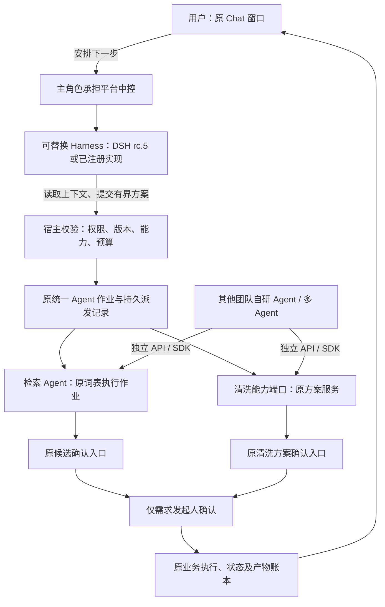

# 平台中控落地：DSH 承载，原业务服务派发

本片在原 Chat 中增加“安排下一步”，用于**已确认的检索/清洗任务**。用户点击后，中控读取真实进度，在已安装能力中安排操作；检索和清洗继续使用原确认入口。提单前自然对话、扩词与改词保留现有成熟路径。数据生产、评测、训练、RHF 暂缓。

## 运行关系



DSH 承载中控的模型循环；原 `AgentJobDispatcher` 派发业务步骤。专业 Agent 可以自带运行框架。图中的清洗端口目前接原清洗模块，不代表真实 Data-Juicer Agent 已接入。采用中控或 DSH 都不是复用单项能力的前提。

## 用户操作与接口

在原检索节点点击“安排下一步”。它沿用当前用户选中的 LLM，不固定切换到检索角色配置的模型。先查询已有中控作业，活动或未知的同版本作业只恢复读取；切换 Chat 清理界面轮询，不取消业务任务。

使用原统一 API，无新增任务体系：

1. `POST /v1/retrieval/tasks/{task_id}/agent-jobs/prepare`，`capability=coordination`、`workflow_ref=platform-coordinator@1`。`planning` 提交 `message`、`model_profile_ref`、`expected_revision`、`expected_generation`、`expected_task_version`。必须是原发起人已有的正式任务；prepare 不创建正式任务、不运行模型。
2. `POST .../agent-jobs/{job_ref}/start`，正文仅 `proposal_digest`、`expected_task_version`。这是本次有界规划授权，**不是候选/清洗确认**。
3. 原 GET/列表返回状态、委派回执与简短建议；不展示提示词、凭据、内部路径。`completed` 表示本次安排取得回执，不表示检索或清洗完成。业务进度、清单和有效数读原模块接口。

中控不接受 `confirm` 或 `cancel`，根任务取消走原任务入口。外部集成凭证继续仅允许已授予的模块能力，不能借 `coordination` 获得平台控制权限。

## 当前能力与限制

| 能力 | 中控可以做什么 | 后续确认/执行 |
| --- | --- | --- |
| retrieval.inspect | 读取原词表执行作业 | 不修改业务 |
| retrieval.ensure | 仅在原需求已确认执行委托、来源仍授权时确保原作业存在；已有作业返回原引用 | 不再生成词表或重复检索；原候选确认仍由用户完成 |
| cleaning.inspect | 读取清单、原清洗作业状态及确认入口 | 未知/失败/运行中不自动重启 |
| cleaning.prepare | 当前清单/版本有效，且不需要额外模型时调用原清洗提案服务 | 只产生待确认方案，不批准、不运行检测器 |

当前 VLM 清洗提供方的 `generate()` 会额外调用模型，因此只发布 inspect，返回原清洗入口；待独立清洗 Agent 与子规划预算接入后再开放自动委派。没有把模型调用隐藏在普通工具中。

每轮最多 4 个有序步骤。`depends_on` 只约束**取得派发回执的顺序**，不代表等待子作业完成。下一阶段需要真实业务产物时，必须在原确认完成后重新读取新版本上下文；本片没有实现跨域事件驱动的完成依赖、并行分支或自动持续闭环。

## 开发接入点

- `platform_coordination.py`：`CoordinationCapability`、发布后封闭的 `CoordinationRegistry`、中控角色和方案验证器。
- `coordinator_jobs.py`：实现原 `AgentJobService` 工作流，使用 `AgentDomain` 与原 Harness 运行端口。
- `adapters/task_storage/coordinator.py`：在原 `agent_job_links` 和 Harness 表持久化授权、模型预算、方案、派发意图和回执；没有第二份 Task 状态机。
- `local_coordination.py`：装配原检索/清洗端口、当前主体模型和发布版本；API 启动时在原清洗服务就绪后安装。

新能力在后端安装 `CoordinationCapability(name, release_ref, kind, describe, invoke)`。`describe` 返回当前可用 actions、输入/授权 `binding_digest` 和状态；`invoke` 调用该域原业务接口并返回可查询的作业/提案引用。自研 Agent 或整个多 Agent 工作流可作为一个能力接入；不能让客户端指定脚本、import、任意地址或扩张工具。真实异步远端接入还需实现自身持久幂等、取消、未知结果核对、产物授权及子资源计量，注册本身不代表这些条件已满足。

中控自身换 Harness 时沿用 `harness-routes@2`：DSH 绑定已安装发布；自研运行器通过后端 `adapters_provider(actor)` 注入 `provider=registered` 的实现对象及摘要，复用相同工具、模型准入与持久恢复。客户端不能动态导入代码。

每轮固定输入范围、能力发布、角色和模型绑定；调用前重新校验。步骤先持久化派发意图，再调用原业务端口。崩溃留下意图但没有回执时返回 unknown，不自动重发；已有回执恢复时跳过已派发步骤。新 revision/generation 不接纳旧结果。并发请求不能替换同版本活动中控作业，旧 task_version 不阻塞新版本。

## 本机配置

在原私有 deployment 配置增加以下字段；缺省关闭，不改变其他部署：

```json
{
  "coordinator": {
    "enabled": true,
    "release_ref": "dsh-rc5",
    "model_calls": 3,
    "generation_model_calls": 30,
    "max_seconds": 60,
    "max_steps": 4
  }
}
```

`release_ref` 必须存在于原 `harness.releases`，使用 `harness-routes@2` 的 coordinator 角色装配，原检索路由保留。DSH 安装、Python 控制器、npm 锁和独立 `DSH_HOME` 均显式绑定；不随配置升级 SDK、不自动回退。示例见 [deployment 配置](../../config/retrieval-agent-deployment.example.json)。

中控每轮预留最多 3 次模型调用，同一根任务 revision/generation 所有轮次共享 30 次上限；失败或未知不退还预留。该模型额度与原物理检索/检测预算分开，不能用步骤拆分重置。外部 Agent 自管的模型/资源不冒称已由本侧计量。

## 验证与后续

定向用例在 [test_platform_coordinator.py](../../tests/test_platform_coordinator.py)：真实 HTTP/原 Chat 控制器、原业务能力复用、确认隔离、版本/撤权、并发幂等、重启/未知不重发、非法能力和代次预算。原生 rc.5 用隔离临时目录和本机确定性模型端点验证，不等于真实模型质量或生产试点验收。实际结果与部署状态记录在 [progress.md](progress.md)。

下一步优先补中控到检索 Agent 的持续多轮反馈与停止条件、未知作业核对；清洗 Agent 独立落实模型预算和真实实现适配。跨团队自助发布、跨域完成事件/人工暂停恢复、根资源分配仍属后续；训练与 RHF 不在本批。
