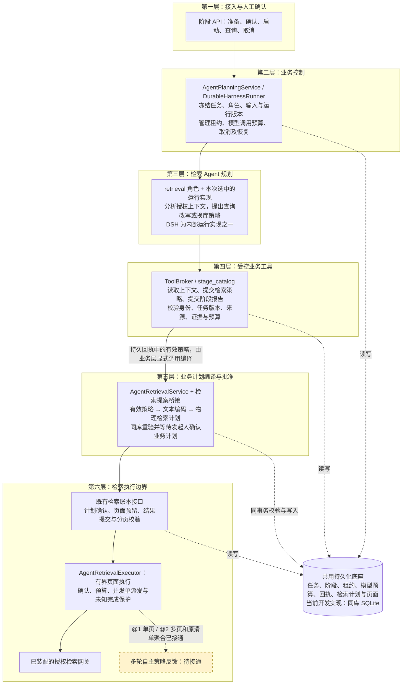

# 当前检索 Agent 分层架构

项目整体职责、清洗/交付、存储、接口、部署及能力状态统一见 [架构总览](../architecture.md)。本页保留检索 Agent 两阶段与独立规划模式的详细分层。

当前默认 Chat 使用检索 Agent 的确认前词表阶段和确认后执行阶段；另外保留可独立调用的规划候选工作流。现场启用和真实验证结果见 [progress.md](progress.md)，不将图中的能力等同于完整自主检索或多团队生产验收。评测、训练和 RHF 仍暂缓，清洗独立开发。

## 默认 Chat 主链路（同一检索能力的词表与执行阶段）

```mermaid
flowchart TD
    subgraph L1[第一层：用户交互]
        C[原 Chat：沟通与澄清]
        K[检索 Agent 词表阶段 retrieval-terms@1<br/>分组扩词 / 分批补词 / 改词与校验]
        Q[(原扩词作业账本：临时词表与批次检查点)]
        U[发起人确认完整词表 / 分组配额 / 来源 / 预算]
        C --> K --> U
        K --- Q
    end
    subgraph L2[第二层：业务确认与派发]
        T[原 Task / revision / generation / 确认摘要]
        O[原持久 outbox]
        T --> O
    end
    subgraph L3[第三层：公共 Agent 框架]
        J[AgentJobService / 注册的工作流 / Dispatcher]
        S[(原 agent_job_links 与共享预算账本)]
        J --- S
    end
    subgraph L4[第四层：检索 Agent 执行]
        A[confirmed-terms-retrieval@1<br/>来源和预算校验 / 原作业恢复 / 取消栅栏 / 产物回传]
    end
    subgraph L5[第五层：受控检索工具]
        E[原多词与多组编译 / 授权路由 / 编码 / RetrievalCoordinator]
        G[已安装检索网关与素材来源]
        E --> G
    end
    subgraph L6[第六层：原业务产物]
        P[原检索页与带分支来源的候选]
        M[发起人确认原 manifest]
        R[输入清单引用 → 独立清洗或外部 Agent]
        F[实际候选覆盖分析 / 原账本与映射 / 证据摘要]
        H[发起人请求调整词表]
        P --> M --> R
        P --> F --> H
    end
    U --> T
    O --> J --> A --> E
    G --> P
    M --> J
    H --> K
```

词表阶段由 RetrievalTermsAgent 负责策略，复用原 ModelRuntime/DshModelRuntime 的模型端口、原 ExpansionJobs 持久队列和 grouped-expansion@1；不另建扩词 Agent，不提前创建正式 Task/run。词表由用户确认后，执行阶段不重复调用模型重写。分组、配额、词/来源标签及原业务计数保留。旧请求省略 `retrieval_execution` 时保持原路径；未知网络结果保留预留、不自动重发；原产物已确认时先恢复原引用。详见[默认窗口接线](retrieval-agent-window.md)。

确认前扩词、用户反馈改词和根据实际候选覆盖调整词表的人工确认闭环已接通。分析复用原页面与候选映射，按需调用原扩词模型；新词确认后才检索。语义质量反馈、跨来源自主切换和自动多轮循环仍需接通，不把原始候选数量当作有效素材数。

## 独立规划候选工作流分层

专业 retrieval 规划角色继续通过版本化 Harness 运行，DSH 是其中一个已安装实现。阶段和业务计划确认独立保留；这部分可经独立 Agent API 使用，不强制插入默认 Chat 的每次已确认执行。



| 层 | 当前代码入口 | 边界 |
| --- | --- | --- |
| 接入与确认 | api.py / harness/stage_service.py | 阶段确认与业务检索计划确认分别保留；查询不启动模型 |
| 业务控制 | harness/agents.py / harness/durable.py | 域/角色匹配、版本固定、持久租约及模型调用次数准入 |
| Agent 规划 | harness/roles.py / adapters/harness/composition.py | retrieval 角色独立于实现；DSH rc.5 和旧版本有本机兼容证据，注册的其他实现仍须能力验证 |
| 受控工具 | harness/tools.py / harness/stage_tools.py | get_stage_context、submit_retrieval_strategy、submit_stage_report；规划工具无任意执行权限 |
| 编译与批准 | agent_retrieval.py / adapters/task_storage/agent_retrieval.py | 只消费有效策略回执；重新解析当前物理绑定/证据/输入，不把报告或最终文字当成检索作业 |
| 检索执行 | agent_retrieval.py / retrieval_agent_jobs.py / adapters/task_storage/retrieval.py | 已批准计划按页入账；统一作业支持@1单页/@2有界多页及原manifest聚合，完整多轮反馈仍待接通 |

## 当前实现范围

- Agent 规划、阶段 API、持久回执、模型调用次数限制、提案编译及原检索计划确认/页面账本已有定向验证。实际 rc.5 验证使用本机确定性模型与编码/页面夹具，不是内网检索或模型质量验收。
- 提案编译首片支持图片文本编码和 rewrite_query/switch_source。该独立策略编译模式的分组/多分支、来源过滤、参考图和视频仍需适配；@2 paginate 已有界接通，retry 提案执行仍需对应适配，不能从角色提示中提及这些动作推断已落地。
- 阶段报告供业务层读取，不进入物理查询编译；只有校验通过的检索策略回执进入第五层。编译和确认之间的撤权、阶段替换、取消及回执变化仍须重验。
- 阶段 API 须显式装配；显式项目可通过原草稿/正式确认准入图片文本纯候选模式，其他 agent_requirements 模式仍关闭。旧任务不自动升级为自主模式，完整多轮检索/清洗反馈协调尚未贯通。
- 现有外部共享 SDK 可调用已确认任务的 first-search/清洗模块；该直接模块复用路径可以不启动本图的内置检索 Agent。默认 Chat 的已确认词表已接入公共检索 Agent 执行工作流；清洗反馈到自主检索的完整闭环仍未贯通。

相关说明：[阶段 API](../../contracts/agent-stage-api.md)、[检索提案桥接](../../contracts/agent-retrieval-handoff.md)、[共享模块接口](../../contracts/shared-capabilities.md)。整体目标的两张总览图见 [业务通路与能力插拔](../architecture.md#15-目标平台与后续业务域)。
