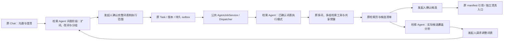

# 原 Chat 窗口接入检索 Agent

增量入口：已确认任务的检索节点可显示“安排下一步”，使用同一个窗口及当前用户选择的 LLM，由可替换 Harness 承载中控规划。实际派发和确认仍走原业务服务，详见 [平台中控落地](platform-coordinator.md)。该入口不接管提单前普通对话，也不将独立清洗 Agent 标为已实现。

默认 `/chat` 保留连续对话和需求澄清；分组扩词、分批补词和词表修改交给 **检索 Agent 的确认前词表阶段**（`retrieval-terms@1`），继续复用原模型适配器和持久化扩词队列。用户确认完整词表后，进入公共作业框架中的 **已确认词表执行阶段**（`confirmed-terms-retrieval@1`），由它管理来源/预算校验、恢复和原候选产物回传；实际逐词检索继续复用已有工具。这是同一个检索能力的两个阶段，不增加一个独立扩词 Agent。对话/扩词模型保持用户选择，确认后不再让另一个模型把整份词表改成单查询。

## 完整职责、历史实现与当前状态

产品目标是一个可独立复用的检索 Agent，包含需求转检索目标、扩词、多来源策略选择、执行、召回质量分析与策略调整。Chat 是用户交互窗口；扩词显示在 Chat 中，不代表扩词应长期归属于 Chat 编排器。清洗 Agent 独立开发。

此前讨论中的“新 Agent”实际混用了两个实现名称，后续应明确区分：

| 实现 | 扩词和执行方式 | 当前使用位置 |
| --- | --- | --- |
| 重构前成熟检索流程 | 原 Chat 扩词、改词和分组确认，原逐词引擎执行 | 当前复用其模型适配器、词表/配额契约、持久队列和多词工具，词表策略已抽出到 Agent |
| 独立候选规划模式 | Harness 规划后执行有界候选检索；未完整承接原分组词表流程 | 独立 API 或显式 candidate 配置，默认 Chat 不进入 |
| 已确认词表执行模式 | 接收完整已确认词表，通过公共 Agent 作业管理执行与恢复，复用原逐词引擎 | 当前默认 Chat 确认后进入，workflow 为 confirmed-terms-retrieval@1 |
| 确认前词表阶段 | RetrievalTermsAgent 负责分组、分批补词、修改和输出校验；旧 ExpansionJobs 仅承担入参校验、排队、版本/权限、持久检查点 | 当前默认 Chat 确认前进入，workflow 为 retrieval-terms@1；不创建正式 Task/run |

当前已经接通确认前词表、确认后执行，以及根据实际候选覆盖提出词表调整的人工确认闭环，不能据此声称检索效果已经优于重构前。语义质量判定、跨来源自主切换和自动多轮策略仍未完成；上游模型真实扩词429也没有因代码拆分而解决。基于召回的新词表仍需发起人确认，不能在原授权下自动扩大词表或来源。

## 自动候选与清洗交接扩展

新装配清洗执行端口后提供 `confirmed-terms-execution@2`。词表确认卡明确展示“候选自动进入现有清洗流程”和图片发送给选定模型的范围，默认不再要求确认候选；可选“先审候选，再自动清洗”。不开补数时只自动处理首轮，交付发布仍须本人确认。

该扩展复用原 manifest、清洗批准和后台，不启动独立清洗 Agent。旧 @1/历史任务及独立规划候选模式保留原门禁；新扩展是否已部署以 progress 为准。下文关于原候选人工确认的步骤继续适用于旧 @1 和可选先审模式。

## 默认 Chat 如何使用

1. 在原输入框描述需求；缺少必要信息时继续补充，明确的需求直接生成待确认词表。
2. 在同一 Chat 中询问扩词理由、增删或替换词语，保留分组配额、历史去重、参考图等原有入口及校验。
3. 词表确认卡说明由检索 Agent 执行，并在执行详情展示授权来源、调用数/原始命中上限。发起人确认具体词表、分组、来源和预算后，原 Task 确认事务保存显式委托，持久 outbox 交给 Agent 作业。草稿和扩词不创建正式任务。
4. Agent 使用完整原词表及原逻辑分支/组 ID 调用已发布逐词工具，不缩减词表或合并配额，不增加一次规划确认。原窗口继续显示业务进度和逐词候选。
5. 发起人仍从原候选确认入口确认原 manifest；作业通过同一公共 Agent API 返回该输入清单引用。检索完成只表示候选就绪，不代表已清洗、有效数量达标或业务 Task 完成；清洗独立执行。
6. 连续改词沿同一长期 Task 的新 revision/generation 派发新 Agent 作业，旧运行不能覆盖新结果。只有清洗条件变化而没有新的检索派发时，不虚构一个待启动检索作业。



本模式接通的是已确认词表执行，不重复运行 DSH 规划。公共框架仍支持独立的 DSH/其他 Harness 规划和有界候选作业；多轮自主改词、换库或扩大预算属于后续策略阶段，不能借本模式越过词表和来源授权。没有把确定性执行接线声称为完整自主策略闭环。

### 确认前词表阶段与 Harness 接入

- 原 Chat 改用 `/dialogue-sessions/{session_id}/retrieval-agent/terms` 和 `/tasks/{task_id}/retrieval-agent/terms`；原 `expansion-jobs` 为同一实例的兼容别名，同请求返回原 job_id，不启动两套规划。新增 `agent` 元数据标识 retrieval-terms@1；状态、进度和最终 grouped-expansion@1 与原词表审阅兼容。见 [词表阶段 OpenAPI](../../contracts/retrieval-terms.openapi.yaml)。
- `RetrievalTermsAgent` 拥有组识别、分批补词、未修改拒绝、配额封装和最终词表校验。存储端每次最多推进一批；模型返回后重新核验会话/任务版本和模型配置，再保存检查点。失败时保留已完成批次；读取不执行、重试必须显式发起，半成品 result 为空。
- `TermsModelPort` 只要求 `binding`、`expand_chunk`、`bind`，当前默认注入原 ModelRuntime/DshModelRuntime，保持原模型、提示词和适配器。接其他 Harness 时用可信部署提供该端口，再构建 `ExpansionJobs(..., terms_agent=RetrievalTermsAgent(model_port))`；队列的 runtime 与该端口应使用同一受控模型配置和凭证作用域。客户端不能上传任意实现、解释器或连接信息。批次输出即使来自其他适配器，也须经过原 grouped-expansion 格式、组名、数量、去重和摘要校验。
- 外部集成在已经绑定的正式 Task 上，经显式 `agent.retrieval.terms.prepare/read` 授权使用 `AgentClient.prepare_terms/terms/retry_terms`；只能提出新词表，不能确认或启动检索。原阶段权限不隐式包含扩词权限。确认前 Chat 的会话入口仍限原可信用户，不通过新能力放开跨团队会话或自动创建正式任务。见 [共享接入](../../contracts/shared-capabilities.md)。

### 召回反馈：复用哪些代码、如何形成闭环

| 原有部分 | 本次复用方式 |
| --- | --- |
| 原批准计划、页面账本与进度 | 读取同一版本的已提交页、未执行/延期来源和未知预留，不重新检索 |
| 原候选映射与 candidate_identity | 按版本化媒体身份统计唯一候选、重复覆盖和未映射，不另建候选模型 |
| recall_strategy | 增加未清洗候选覆盖建议；原清洗后有效产出排序继续保留，不混用口径 |
| ExpansionJobs / RetrievalTermsAgent / ModelRuntime | 原队列和模型端口接收服务端召回上下文，复用分批生成、恢复、校验和词表预览 |
| 原反馈草稿、confirmations、Task/outbox | 新词表仍由发起人确认；同一个Task进入新revision/generation，旧回传不能覆盖 |

当前 LOCAL_EXACT/LOCAL_CLIP 的 `recall(actor, task_id)` 返回 `retrieval-recall@1`。Agent 完成本轮检索时将分析保存在原 agent_job_links；作业只暴露记录状态、证据摘要和来源版本。GET `/tasks/{task_id}/retrieval-agent/recall` 会重新授权并读取当前证据，不调用模型、编码或搜索。前端在原检索节点提供“分析本次召回”，逐词展示命中、首次贡献、重复覆盖、未映射和未执行来源；不把分析字段塞进普通对话的每条消息。

- 唯一候选使用原版本化媒体身份，不是精确内容去重或清洗有效数。“新增”按批准成员、页面、命中顺序首次归因，不是查询语义贡献的因果判断。至少一半已映射命中重复时建议增加场景差异；复用原候选清单的归组、完整内容摘要及参考图排除规则，单独给出assignable_candidates；整句独有且无法归组的候选保留在全局唯一数中，不冒充可入清单数量。逐组可归属候选少于该组目标时可建议拓展词义，逐组覆盖数不能直接相加当全局唯一数，但不把它称为有效素材缺口。accepted_count、全库召回率仍为null，语义相关性为not_assessed。
- 分析范围是当前检索窗口；延期/未执行来源不算零收益。失败、未知、尚未完整或映射不全时不给此模式改词权限。当前分析有100成员、100已提交页（沿原账本限制）、10000命中上限；超限明确拒绝，不截断后声称完整分析。
- “根据召回调整词表”是一次显式模型请求，调用原terms POST，仅增加 `recall_evidence_digest`。后端重新读取当前报告，把核验过的统计传给原模型端口；客户端不能上传报告冒充证据。保留原始主体、分组、上级分类、辅助词数量和已确认配额，包括原文没有再写出的配额；其他数量/主题变更仍走普通修改流程。
- 队列保存来源摘要和上下文，每批模型返回前后均核对当前任务、模型及召回证据。证据变化或撤权后拒绝发布；失败批次按原机制恢复，半成品不可确认。完成仅返回待确认词表，不触发检索、清洗或业务计数。发起人确认后沿原outbox启动新代次，并记录旧分析来源。
- 外部Agent需显式 `agent.retrieval.recall.read`，通过 `AgentClient.recall(task_id)` 读取已绑定根任务的分析；词表提案继续使用独立terms.prepare权限，不获得确认权。其他检索连接器实现相同recall端口后才能启用；缺失返回RECALL_UNAVAILABLE，不回退另一来源或Harness。真实语义质量、跨库自主切换、自动循环的轮数/时间/无进展停止策略仍是后续工作。

### 开发接线与恢复

- `query-spec@2.retrieval_execution` 为显式、规范化的确认字段，契约见 [JSON Schema](../../contracts/confirmed-terms-execution.schema.json)。它绑定已发布 workflow、授权 binding IDs、检索调用/命中上限和策略摘要。保存草稿不执行，正式确认前及同一确认事务内重验部署/来源。旧请求省略字段时保持原行为，不自动迁移旧任务。
- `SearchDispatchCoordinator` 只把有该委托的 outbox 交给 Agent；未安装实现保留派发意图并拒绝回退旧执行。委托模式的旧 first-search 执行写入口拒绝直通，原候选确认和清洗入口保留。
- 作业复用原 `agent_job_links` 和 `AgentJobRegistry/AgentJobService/AgentJobDispatcher`，没有平行业务 Task、词表或审批。已确认执行模式的 job_ref 为同一词表代次的稳定作业引用；保留原 `agentdraft_...` 路由格式，但不伪造模型阶段草稿或模型运行。
- 预算上限在原 Agent 作业意图事务中写入共享预算账本，尚未派发时计数为 0；重启提高运行配置不会放大既有确认预算。原查询/页/候选数量与清洗有效数继续分开。
- 已提交页面和原 manifest 是恢复依据；作业关联未写完时先查原已确认产物，禁止重跑检索。未知网络/页面提交保留原预留、停止重发；读取 workspace/job/artifacts 不编码、不检索、不确认。已有确定产物的读取不会把旧未知状态当作空成功。
- 部署端通过 `ConfirmedTermsRetrievalAgent(service, engine, links, sources_provider)` 安装已发布执行端口并注册 workflow。当前 LOCAL_CLIP 装配已接入；这一模式不依赖具体 Harness SDK。独立装配可只安装该执行模式，其他 Harness/独立 Agent 在公共接口外消费/提供任务与策略，不能提交任意连接、代码或自称已批准。

外部接入已有确认委托的 Task，可使用 `AgentJobClient.prepare(..., workflow_ref="confirmed-terms-retrieval@1")`，`planning` 仅传期望的 revision/generation/task_version；重复调用查回原作业。无需再发 start/planning 确认。集成凭证没有确认权限，原候选确认仍由发起人执行；状态和输入清单通过同一 get/artifacts 读取。

## 独立候选模式（显式选择）

只有可信部署配置显式设置 `chat_entry: "candidate"` 时，新 Chat 才走下面的有界候选流程。`conversation` 为默认值；旧部署配置省略该字段时恢复普通对话。`enabled` 仅控制独立 Agent API 准入，外部 Agent 可以继续单独调用，不代表 UI 强制使用它。配置故障或独立规划服务不可用不阻断需求沟通；在确认执行前必须核对当前执行范围，不能静默降级或扩大授权。

1. 在原输入框写明图片主题及数量，例如“找 5 张客厅图片”，数量须在项目返回的上限内；也可使用原数量设置。
2. 审阅原窗口中的需求确认卡，看到来源、页数/每页上限、规划预算及未清洗说明，再确认需求。草稿不创建正式任务或调用模型。
3. 确认并开始规划，等待检索计划；确认计划后才在批准范围内检索。默认一页，显式启用多页时按原游标继续，达到候选期望或上限后停止。
4. 在原候选窗口查看授权图片，再确认候选清单；交付的是原 manifest 引用。
5. 刷新或从历史打开同一任务只读取当前状态；需要确认、准备或启动时明确点击卡片。取消会先持久化根任务代次栅栏。执行结果未知时保留状态，不因刷新自动重试。

清洗、补数、打包节点显示“本次不执行”。候选未经筛选/打标/质量验收，accepted_count 和 gap 保持 null；本次有界检索未达到候选期望不自动补数，也不将业务任务标作清洗完成。原始命中、跨页唯一候选和清洗有效数量分别展示。按整页检索，末页可能超出期望，需求和检索卡展示此边界。

## 后端如何启用

当前 LOCAL_CLIP 启动入口可在原命令后追加 `--retrieval-agent-config /absolute/private/retrieval-agent.json`，结构见 [部署示例](../../config/retrieval-agent-deployment.example.json)。必须使用既有持久 Task 账本、已配置模型、CLIP 编码器和授权媒体网关，不支持 browse-only 或 LOCAL_EXACT 冒充真实语义检索。该桥接仅用于现有本机 demo 项目；真实平台应使用自己的授权/检索/媒体端口装配，不沿用模拟身份。

模型凭据继续从当前主体的原模型设置解析，配置只保存 profile 引用。新角色的 profile 可以与 Chat 默认模型不同，确认卡明确展示；不会写回原默认模型。授权上下文提供确认需求和已授权来源的证据引用，未提供召回指标时不制造质量证据。模型绑定摘要包含凭据版本绑定，轮换后旧规划确认失效。

下面是可供其他可信部署入口使用的程序装配方式。

先完成已安装运行实现、授权模型、索引能力、检索网关和候选物化器的可信装配，参见 [作业服务](../../contracts/agent-jobs.md)。然后在创建 HTTP handler 前显式启用：

```python
from dsh_retrieval.agent_jobs import AgentJobDispatcher
from dsh_retrieval.adapters.harness.composition import enable_retrieval_agent_window
from dsh_retrieval.api import create_handler

worker = AgentJobDispatcher(jobs, start=True)
window = enable_retrieval_agent_window(
    task_service, jobs, worker,
    enabled_projects=frozenset({project_id}),
    model_profile_ref=model_profile_ref,
    sources_provider=authorized_retrieval_sources,
    cursor_secret=secret_provider.candidate_cursor_secret(),
    max_model_calls=2, max_seconds=60,
    chat_entry="conversation",  # candidate 仅用于显式选择的独立候选窗口
)
handler = create_handler(task_service)  # 自动引用 window.jobs
# 应用退出时先 worker.close()，再 planning.close()。
```

以上变量由部署方注入，不包含真实地址、模型配置或凭据。`authorized_retrieval_sources(actor, project_id)` 必须重验当前身份/项目及库访问权限，返回已发布且存在于 compiler.capabilities 的 `IndexBinding` 非空 tuple。该回调是授权边界，不能直接相信用户提交的库名。签名密钥至少 32 bytes，生产须来自可信密钥提供方并在实例/重启间保持一致。

多页需要在构建 jobs 时显式传 `build_retrieval_agent_jobs(..., batch_size=25, max_pages=3)`；页数上限为 2–10，默认 1 不变。多页产生 `retrieval-agent-job@2`，同时支持读取原 @1。需求须声明 paginate，原窗口根据项目配置展示并在确认卡中明确；缺少该授权只允许一页。每页批量还受已批准库的能力限制，总原始命中上限为页数×每页上限，最多 1000，不保证全部唯一或通过规则。

多页作业保存准备时的页数/候选期望和实际每页上限，检索计划确认摘要绑定该分配。后续部署改变 max_pages 不改变已有作业。每次后台推进最多一个网络搜索请求；崩溃后从原已提交页及游标恢复，未提交预留保留 unknown，不重发、不假作空页。清单确认一次原子发布各页原 manifest 和作业关联；任一页撤权/内容变化或关联保存失败都不能部分交付。

TaskService、阶段 journal、检索、候选和 job links 必须共用同一持久 SQLite 账本，本片不新增必装数据库。窗口启用不决定 Harness：实际实现继续经已安装发布和后端项目角色路由解析；缺少能力或 probe 失败拒绝确认，不回退其他实现。运行时安装与真实环境验证沿原流程单独完成。

准入在确认前和 SQLite 正式确认事务内各检查一次；撤权/绑定不可用时回滚 Task、batch 和草稿正式绑定。确认后准备规划失败，正式 Task 仍可通过原草稿查回，在同一窗口显式重试准备，不再创建 Task。草稿保存和只读配置发现不会调用模型。

## 接口与兼容边界

| 接口 | 用途 |
| --- | --- |
| GET `/v1/retrieval/projects/{project_id}/agent-retrieval` | 只读项目开关、主体范围、授权来源、候选和预算上限；未配置返回 enabled=false |
| POST `/v1/retrieval/tasks/{task_id}/agent-retrieval/prepare` | 空对象与幂等键，显式准备或查回本任务当前作业；不确认/启动 |
| 原 drafts / tasks | 保存草稿及发起人确认正式任务；新 Task 不进入旧搜索 outbox |
| 原 workspace / candidates / preview | 读取新作业进度、签名分页与授权图片；没有查询副作用 |
| agent-jobs 的 confirm / start / cancel / artifacts | 原发起人各节点确认、启动、根任务取消和清单引用 |

接口细节见 [OpenAPI](../../contracts/agent-jobs.openapi.yaml)。新项目配置/prepare 路由供原窗口使用，不自动授予集成凭证；外部 Agent 继续通过具有明确授权及根任务关联的 [共享 SDK](../../contracts/shared-capabilities.md) 调用 agent-jobs。

仅 `agent-requirements@2`、空 processing、input_only 的独立检索允许 autonomy.library_ids 单独声明非空来源；input_only 在这里限制后续补数，不禁止已明确委托的初次检索。它不继承或伪造 refill_policy.approved_library_ids，后者保持空数组。旧 @1、清洗输入模式及已有摘要不升级，来源字符串不授予访问权。

本片只支持有界图片文本候选、默认维度、全人工节点，受来源能力、batch_size、max_pages 和原搜索预算限制。过滤/打标/尺寸规则、分组、参考图、视频、历史去重、补数、多轮策略反馈及修改原任务均未开放。界面不把处理诉求转换成已清洗承诺；确认卡必须展示未经清洗。新 Agent 任务的旧 first-search/cleaning/refill/delivery/对话执行写入口拒绝调用，旧反馈确认也不能绕过新模式准入。

多页产物顶层 candidate_count 为媒体身份去重后的唯一数，items 是各页原 manifest 引用；不要将各页数量相加作为唯一总数。原候选窗口汇总各页命中。页面集合在检索中变化时，旧签名分页/预览引用失效，需要重读当前集合，防止跨版本混读；正式候选发布后可稳定分页。清洗仍消费授权原清单，未在本片启动。

## 验证与后续

定向用例以临时 SQLite、确定性运行器/编码/检索及合成 PNG 验证公开 Task 确认、同窗人工节点、候选分页/预览、取消、撤权、旧入口隔离。Node 执行原发送函数和实际页面控制器，通过本机 HTTP 完整调用后端；这不是浏览器视觉验收或真实模型质量验证。

后续先完成可信部署配置接入及真实身份/两来源/模型/持久恢复试点，再接多轮召回反馈和连接器未知结果核对。清洗 Agent 单独实现；评测、训练、RHF 暂缓。多页定向用例见 [test_agent_job_pages.py](../../tests/test_agent_job_pages.py)，进展及测试结果见 [progress.md](progress.md)。
